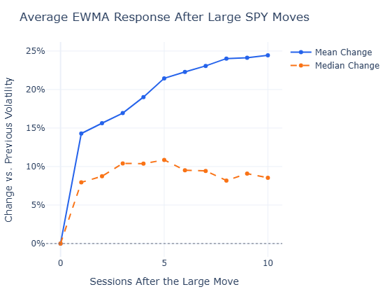
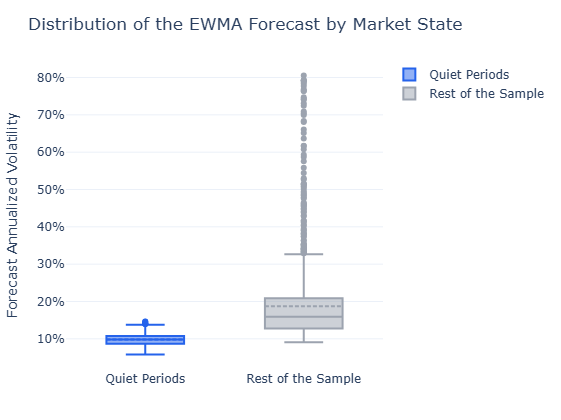

}}" hidden>

<a href="https://github.com/ADRIANVM117/quant-research-notes/tree/main/volatility_target/01_rebalancing_policies" target="_blank" rel="noopener noreferrer">Repository &amp; documentation · GitHub</a>

---

## Why Start with EWMA?

When I began studying volatility models, I was drawn to progressively more sophisticated approaches: GARCH, stochastic volatility models, and, eventually, machine learning techniques.

However, as I developed the risk components for my own Quant Desk, I began to consider a more important question: **what do I really need to understand about a volatility model before using it to make investment decisions?**

A model may be correctly implemented and behave as we expect mathematically. That does not necessarily mean it forecasts future risk well. And even if its forecasts proved useful, we would still need to show that incorporating them into a strategy creates economic value.

These are three distinct questions, and I think it is important not to conflate them.

That is why I chose to begin with a relatively simple model: **Exponentially Weighted Moving Average (EWMA)**.

In this first installment, I use real daily SPY data to study how the volatility estimate evolves, how it responds after extreme moves, and what happens during relatively quiet periods.

My aim is not to show that EWMA is superior to other models, but to understand what information it gives us, where its limitations lie, and which questions we need to resolve before using its estimates to manage exposure and risk.

The full implementation and experiments are available in the notebook that accompanies this publication.

## When Markets Move Violently

One of the first questions I wanted to answer was how estimated risk changes after an extreme market move.

Using daily SPY data, I identified **112 sessions** whose absolute returns exceeded a **2.30%** threshold, corresponding to the 95th percentile of the historical sample.

After these moves, the EWMA volatility forecast for the following session rose, on average, **14.68% relative to its previous level**.

But what proved interesting was not only the immediate reaction, but what happened afterward.

Five and ten sessions later, estimated volatility remained above the level observed before the event. Rather than fading quickly, estimated risk stayed elevated during periods of turbulence.

This highlights an important distinction: **EWMA has memory by construction, but markets can also experience consecutive extreme moves**. When both phenomena coincide, the estimator can remain elevated for longer than the isolated effect of a single shock would suggest.

{#fig-ewma-shock-response fig-alt="Mean and median percentage changes in EWMA-estimated volatility after extreme SPY moves."}

Another observation was the difference between the mean and the median: a small number of particularly intense episodes raised the average considerably.

In other words, EWMA does not only reflect the size of the latest move; its estimate also depends on the recent sequence of returns.

However, none of this yet demonstrates that it correctly anticipates future volatility. What we have observed is how the estimator responds to the history it has just received.

## What Happens When the Market Is Calm?

After studying extreme moves, I wanted to examine the opposite case: what happens to EWMA when SPY goes through periods of relative calm?

To identify them, I used **20-session** windows and calculated the average of absolute returns. I classified as quiet those observations in the bottom 25% of this measure, equivalent to an average daily move of **0.50% or less**.

The result was a substantial difference.

During the **553 quiet sessions**, the median annualized volatility estimated by EWMA was **9.85%**, compared with **15.91%** across the other 1,653 sessions.

But the difference was not only in the level of volatility.

During quiet periods, the estimates were much more concentrated and the mean was virtually identical to the median. In the rest of the sample, the mean substantially exceeded the median, reflecting the influence of turbulent episodes.

{#fig-ewma-calm-periods fig-alt="Distribution of annualized EWMA-estimated volatility during quiet periods and the remaining SPY sessions."}

This shows how EWMA reflects different historical risk conditions: its estimates are lower and less dispersed when recent moves have been contained, while extreme episodes can substantially raise the distribution.

However, there is a fundamental distinction: **we identify quiet periods using observed historical moves, not through an advance prediction from the model**.

We therefore find a coherent descriptive relationship, but we have not yet shown that EWMA can anticipate when a calm period will begin or end.

## What EWMA Has Not Yet Shown

EWMA allowed us to understand how estimated risk evolves, how it responds to extreme moves, and why it can remain elevated after a shock.

However, **we have not yet demonstrated predictive ability or justified that using these estimates creates economic value**. A model working mathematically does not mean it helps us make better decisions.

Before moving on to GARCH or more sophisticated models, I want to explore that distinction. In the next installment, I will evaluate **exposure and banded rebalancing policies**, incorporating costs, constraints, and benchmarks to investigate whether using EWMA improves risk management or investment outcomes.

Perhaps we will find that a simple policy adds more value than a complex model. Or that, under certain conditions, it is better not to intervene.

---

*The experiments, calculations, and checks for this installment are available in notebook 01 of the Volatility Targeting series.*

<a href="https://github.com/ADRIANVM117/quant-research-notes/tree/main/volatility_target/01_rebalancing_policies" target="_blank" rel="noopener noreferrer">Repository &amp; documentation · GitHub</a>

