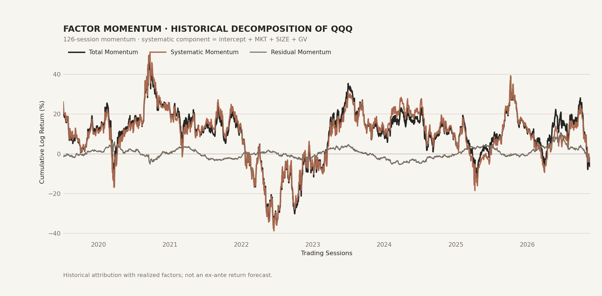
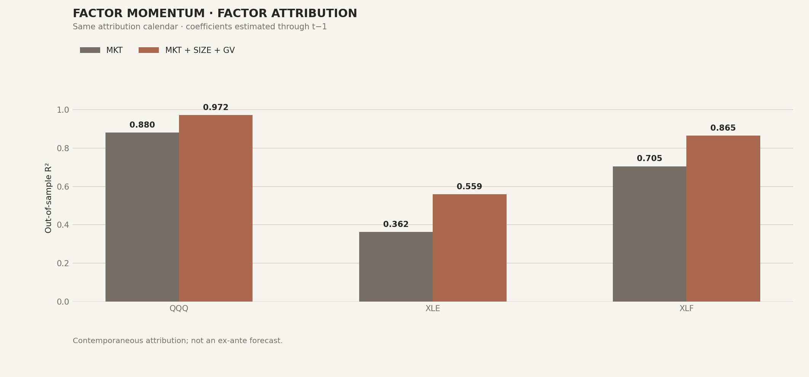
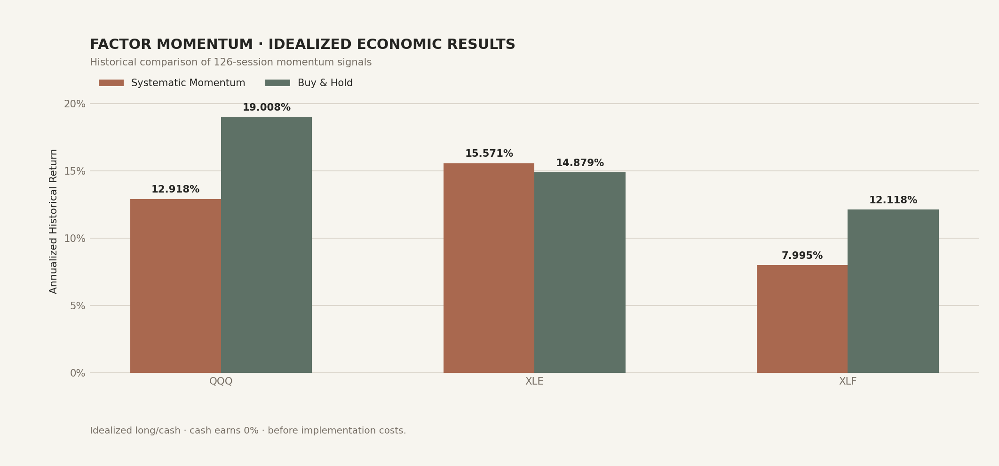

}}" hidden>

  <a href="https://github.com/ADRIANVM117/quant-research-notes/tree/main/Momentum_systematic_strategies/02_factor_momentum" target="_blank" rel="noopener noreferrer">Research RepositoryGitHub</a>
  
  

A model can explain a large share of an asset's observed variation and still not help us build a better investment strategy.

This was one of the contradictions I encountered while investigating momentum from a factor-based perspective.

In QQQ, a model incorporating three systematic proxies achieved an attribution R² of **0.972**. Yet when I used the systematic component to construct a momentum signal, the strategy produced a gross annualized return of **12.918%**, compared with **19.008% for Buy & Hold** in the same idealized experiment.

How can a model explain observed returns so well without translating into a more profitable investment strategy?

The answer begins by recognizing that **explaining a return, anticipating its direction, and earning an economic profit are different problems**.

To investigate this, I studied seven ETFs, constructed a factor-based decomposition of their returns, and assessed whether systematic momentum could contribute useful information relative to simpler signals.

My goal was not to find the model with the highest R², but to understand what information it captured and how far it could be used to support investment decisions.

## 1. Decomposing an Asset's Return

When we observe an asset rising or falling, its movement does not necessarily reflect characteristics exclusive to that instrument.

Part of its behavior may be related to the broad market, differences between large and small companies, or the relative performance of growth and value companies.

To study these relationships, I used seven ETFs: SPY, QQQ, IWM, IWD, IWF, XLE, and XLF. From their returns, I constructed three factor proxies:

- **MKT — Market:** represented by SPY.
- **SIZE — Relative Size:** the difference between IWM and SPY.
- **GV — Growth versus Value:** the difference between IWF and IWD.

These proxies are neither independent nor perfectly isolated factors. They are observable approximations for studying movements shared across assets.

Using **252-session rolling OLS regressions**, I estimated each ETF's historical sensitivity to these components.

The coefficients are estimated using information through the previous session. Then, factors observed at the close make it possible to decompose the day's return into a **systematic component**, which includes the intercept and the factor contributions, and a **residual component**, corresponding to what the model does not explain.

This distinction is fundamental: **attributing a return after observing the day's factors is not the same as having forecast it before the session**.

I then used **126-session** windows to study the cumulative momentum of the total, systematic, and residual components.

{#fig-factor-momentum-decomposition fig-alt="Time-series chart of QQQ total, systematic, and residual 126-session momentum, expressed as cumulative log return."}

This separation makes it possible to observe how an asset's historical trend relates to the movements attributed to our proxies.

But it introduces another question: **does explaining a larger share of observed returns mean we have found information that is more useful for anticipating the market?**

## 2. When the Model Explains More, What Have We Learned?

To examine how much the additional components contributed, I compared two specifications: one with the market as the sole proxy and another that also includes SIZE and GV.

The results showed meaningful improvements in attribution R².

For **QQQ, it rose from 0.880 to 0.972**; for **XLE, from 0.362 to 0.559**; and for **XLF, from 0.705 to 0.865**.

{#fig-factor-momentum-r2 fig-alt="Bar chart comparing the R² of MKT and MKT plus SIZE and GV models for QQQ, XLE, and XLF."}

QQQ's result appears especially compelling: the full model explains a very high share of variation in its daily returns.

However, **explaining 97.2% of that variation does not mean anticipating 97.2% of its movements, nor that the same share of its cumulative momentum is systematic**.

Although the sensitivities were estimated from earlier data, the model needs to know the proxies' realized returns during the session being evaluated. This is contemporaneous attribution, not the accuracy of a forecast available before the movement.

I also found that this attribution ability was not stable. For XLE, the full model's R² fell to **0.284 during 2023–2026**, well below its aggregate result.

This suggests that the relationship between the energy sector and our proxies can change under different market conditions.

The decomposition helps us understand observed returns. What still needs to be investigated is whether it can be turned into a useful decision for the next session.

## 3. From Systematic Returns to a Momentum Signal

Understanding an asset's historical behavior is not the same as deciding how much to invest tomorrow.

To study this second question, I constructed a cumulative momentum measure over **126 sessions** from the systematic component.

I wanted to investigate whether the persistence of movements attributed to common factors could provide useful information for deciding when to maintain exposure.

With that measure, I evaluated a **long/cash** policy: maintaining exposure to the asset when the signal indicates it and remaining in cash when it does not.

Timing is fundamental here.

The factor coefficients used to attribute each session's return are estimated using information through the previous day. At the close of \(t\), realized factors are observable and make it possible to update the systematic component and its momentum.

**The position decided with that information is applied only to the subsequent return, at \(t+1\).**

This separation prevents using the same return we are trying to evaluate to retrospectively determine the position.

To assess whether the decomposition added anything beyond simpler alternatives, I compared Systematic Momentum with three benchmarks: traditional time-series momentum (*TSMOM*), Market Momentum, and Buy & Hold.

The evaluation uses log returns and assumes that cash earns no interest. It is an idealized experiment, with no executed orders and without all the frictions of a real operation.

Respecting this time sequence is necessary to evaluate the signal, but **avoiding future information does not demonstrate predictive ability**.

The next question is economic: what happened when we applied the same methodology across different assets?

## 4. The Evidence Does Not Favor Every Asset

The results differed by asset.

For **QQQ**, Systematic Momentum produced a gross annualized return of **12.918%**, compared with **19.008% for Buy & Hold**.

For **XLF**, the comparison also favored the passive strategy: **7.995% versus 12.118%**.

XLE produced a different result. Systematic Momentum reached **15.571% annualized**, slightly above **14.879% for Buy & Hold** and considerably above **5.615% for TSMOM**.

{#fig-factor-momentum-performance fig-alt="Bar chart of annualized historical returns for Systematic Momentum and Buy & Hold across QQQ, XLE, and XLF."}

These contrasts show that **better factor attribution did not translate into generalized economic superiority**.

We should also remember that Buy & Hold and long/cash policies maintain different exposures; comparing their returns alone is not the same as comparing strategies with the same risk.

The case of XLE deserves closer attention, but also caution.

When I evaluated the association between its 126-session systematic momentum and its future 21-session returns, I found a Spearman correlation close to **−0.016**. This nearly null monotonic relationship does not, on its own, provide convincing evidence of predictive ability.

In addition, XLE's gross advantage over Buy & Hold proved sensitive to costs.

After applying an illustrative penalty of **10 basis points per position change**, Systematic Momentum's annualized return fell from **15.571% to 14.601%**, below Buy & Hold's 14.879%.

This simplified sensitivity does not replicate orders, execution prices, or all the frictions of a real operation.

Nor can we attribute XLE's favorable difference to SIZE or GV separately: the experiment does not causally identify the incremental contribution of those proxies to the strategy.

Finally, **XLE was selected retrospectively after examining the results of several assets**. Its behavior is an exploratory observation, not an independent validation of the hypothesis.

The signal deserves further investigation, but it does not yet represent a demonstrated investment edge.

## 5. From Statistical Explanation to an Investment Candidate

This research began by asking how much of an asset's momentum could be related to systematic market movements.

The factor decomposition made it possible to study those relationships and substantially improve contemporaneous return attribution. Yet we found that **explaining the past better does not guarantee anticipating what comes next**.

When this information was turned into investment signals, the results differed across assets. QQQ and XLF did not outperform Buy & Hold in gross annualized return, while XLE showed a modest historical advantage that was sensitive even to a simplified cost penalty.

In addition, XLE was selected after observing the results of several alternatives. Therefore, its behavior does not constitute independent validation or demonstrate a persistent predictive edge.

But that uncertainty does not mean the hypothesis should be discarded immediately. It means it needs to be subjected to a different evaluation.

So far, I have worked with long/cash signals and idealized returns. I had not yet represented how those decisions would become orders, whole shares, available cash, and trades subject to frictions.

**In the next installment, I will bring the XLE signal into an execution simulation**, incorporating opening prices, commissions, slippage, and corporate actions to investigate how the results change when moving from a theoretical allocation to a simulated portfolio.

It will not be a demonstration of future profitability or a prospective validation of the signal. It will be an additional assessment of its economic and operational limits.

**Before asking whether a strategy deserves real capital, I need to understand what happens when I try to take it from a mathematical signal to executable decisions.**

  <a href="https://github.com/ADRIANVM117/quant-research-notes/tree/main/Momentum_systematic_strategies/02_factor_momentum" target="_blank" rel="noopener noreferrer">Research RepositoryGitHub</a>
  
  

