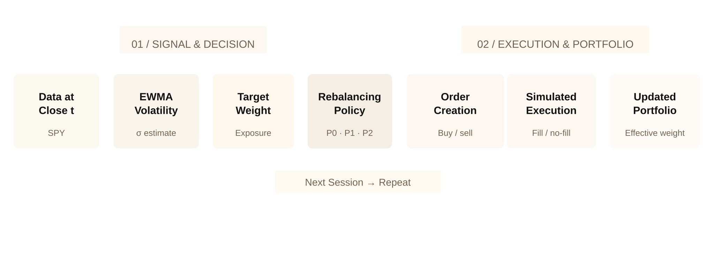
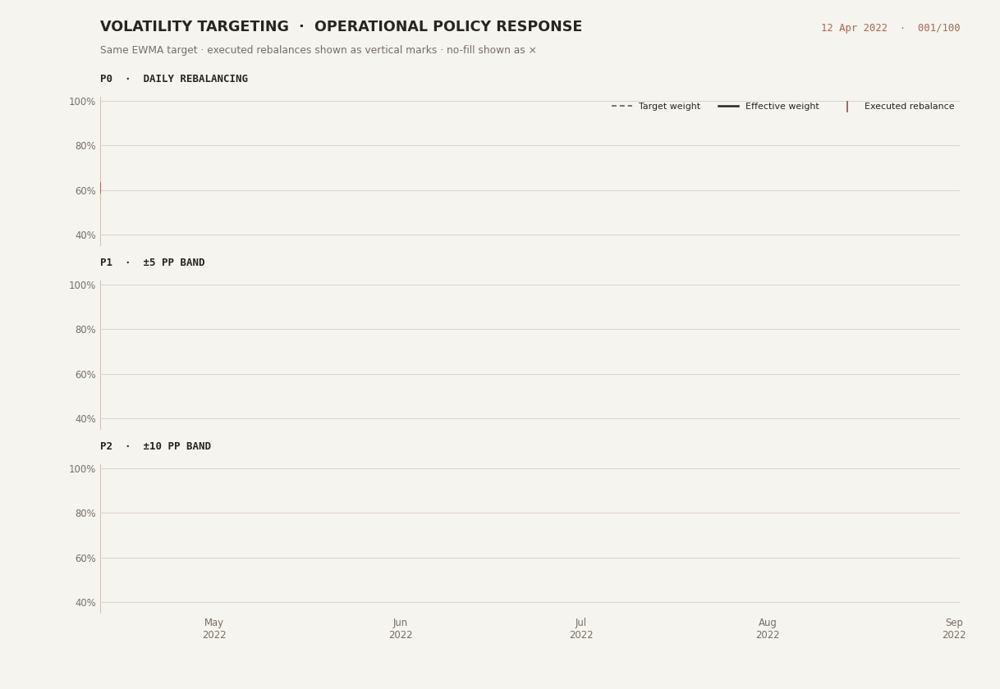

}}" hidden>

  <a href="https://github.com/ADRIANVM117/quant-research-notes/tree/main/volatility_target/01_rebalancing_policies" target="_blank" rel="noopener noreferrer">
    
    Repository &amp; DocumentationGitHub
  </a>
  

In the first installment, I examined how EWMA responds to extreme movements and quiet periods. The next step seemed simple: use that estimate to define a target exposure, apply rebalancing bands, and compare policies.

However, a more interesting problem emerged.

**How could I know what would actually have happened if I had tried to apply those policies in every historical session?**

A signal calculated at the close is not the same as an executed trade. The market may open at a different price, an order may not be filled, the portfolio accrues dividends, and costs affect available capital.

What initially seemed like a simple rule became an exercise in chronology, execution, and accounting.

This installment is precisely about that: **what it means to build a backtest that does not use future information and represents, under explicit assumptions, the decisions a strategy could have made.**

## 1. From a Signal to an Executable Decision

The first step was to transform the EWMA estimate into a desired exposure.

I used a **12% annual** target-volatility rule to determine what proportion of the portfolio I should hold in SPY. When estimated volatility rises, I reduce the desired exposure; when it falls, I can increase it, without exceeding 100%.

The rule is simple:

$$
w^*_{t+1|t}=\min\left(1,\frac{0.12}{\widehat{\sigma}_{t+1|t}}\right)
$$

But an important distinction appears here: **the target weight is not necessarily the weight my portfolio actually holds**.

Effective exposure also depends on market movements, existing positions, available cash, and the trades that are actually executed.

I therefore needed more than an allocation rule. I built an engine that connects the information available, rebalancing decisions, order preparation, simulated execution, and portfolio accounting.

{#fig-vt02-backtest-engine fig-alt="Causal-flow diagram from data at the close and EWMA volatility to target weight, rebalancing policy, order, simulated execution, and the updated portfolio."}

The goal was not merely to calculate how much I should invest, but to represent what would have happened had I tried to put that decision into practice.

## 2. Today's Close Is Not Tomorrow's Open

One of the first problems I encountered was chronology. **Knowing a signal at the close of a session does not mean I can trade at that same price.**

In my backtest, at the close of $t$ I observe returns, update EWMA, and calculate the target weight. With the available positions and cash, each policy decides whether it needs to rebalance and prepares its order.

Execution occurs at the open of $t+1$, where conditions may be different.

To approximate a real-world implementation, I used **Limit-on-Open (LOO)** orders for purchases and **Market-on-Open (MOO)** orders for sales. A purchase may not be executed if the opening price exceeds the limit price; when it is executed, the engine incorporates commissions and slippage.

{#fig-vt02-causal-timeline fig-alt="Timeline from the close of session t to the open of t plus one, separating observed data, EWMA estimate, exposure decision, order, fill or no-fill, costs, and effective portfolio."}

Here I understood that **a decision that is correct given the information available does not guarantee reaching the desired exposure**. Between those two things lie prices, orders, frictions, and constraints that the backtest needs to represent.

This does not turn the simulation into a perfect market replica: for example, assuming a full fill when an LOO purchase meets its limit remains a simplification. But it does make it possible to distinguish what I would have decided from what my model assumes I would have executed.

## 3. Three Policies, One Signal, Different Decisions

Once the engine was built, I compared three rebalancing policies using exactly the same EWMA signal:

- **P0 — Daily rebalancing:** seeks to adjust exposure toward the target weight in every session.
- **P1 — ±5 percentage-point band:** allows some deviations before rebalancing.
- **P2 — ±10 percentage-point band:** tolerates larger deviations and can therefore trade less frequently.

The difference seems simple, but its operational consequences are important: **having the same target weight does not mean making the same decisions or ending with the same effective exposure**.

To observe this, I selected a period of 100 historical sessions, from April 12 to September 2, 2022, using a criterion based on operational activity rather than policy returns.

{#fig-vt02-policy-comparison fig-alt="Animation of 100 sessions with three panels for P0, P1, and P2. Each panel compares target and effective weights, marks executed rebalances, and shows a no-fill where applicable."}

In this period, P1 executed **11 rebalances**, while P2 made **2**. We also observe one P1 order that did not execute.

The GIF makes it possible to see something that a performance comparison would not show directly: bands reduce the need to intervene, but in exchange they allow the portfolio to remain further from the desired exposure.

**Trading less does not necessarily mean trading better.** I still need to evaluate whether the costs avoided compensate for the risk deviations I accept.

## 4. A More Realistic Backtest Does Not Guarantee a Profitable Strategy

This notebook taught me that building a credible historical simulation involves much more than applying a signal to a historical return series.

I need to distinguish what information was available, what decisions I could make, what orders I would have attempted to execute, and how those trades would actually affect my portfolio.

The engine incorporates these differences through execution rules, costs, cash, and constraints. However, it remains a simulation with assumptions and simplifications, not a perfect reproduction of the market.

And here a fundamental distinction emerges: **a policy trading less does not mean it manages risk better or produces better economic results**.

For now, I have built an environment to investigate these questions, but I have not yet justified which policy adds more value.

The next step will be to evaluate the differences with statistical and economic metrics, taking into account risk taken, costs, and relevant benchmarks.

**Before asking which strategy wins, I need to make sure I am comparing decisions that I could actually have made.**

  <a href="https://github.com/ADRIANVM117/quant-research-notes/tree/main/volatility_target/01_rebalancing_policies" target="_blank" rel="noopener noreferrer">
    
    Repository &amp; DocumentationGitHub
  </a>
  

