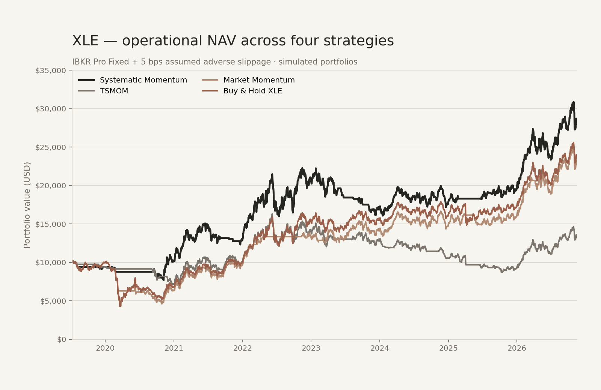
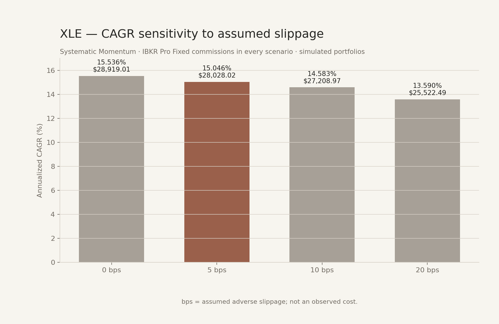

}}" hidden>

  <a href="https://github.com/ADRIANVM117/quant-research-notes/tree/main/Momentum_systematic_strategies/02_factor_momentum" target="_blank" rel="noopener noreferrer">Research RepositoryGitHub</a>
  
  

In the previous investigation, I found that a systematic momentum signal applied to XLE produced historically interesting results, although they were sensitive to costs.

Its idealized annualized return reached **15.571%**, slightly above Buy & Hold's 14.879%. However, that difference disappeared once a simplified 10-basis-point penalty per position change was introduced.

In addition, XLE had been selected after examining other alternatives. Its results represented an exploratory observation, not independent evidence of an investment advantage.

But one more practical question remained:

**What would have happened if I had attempted to turn those signals into orders and positions within a capital-constrained portfolio?**

Up to that point, the evaluation used a long/cash rule applied directly to subsequent returns. It did not need to resolve how many shares to buy, how much cash to retain, or at what price each decision would have been executed.

To investigate those differences, I retained the selected XLE signal and built a simulation that incorporates opening prices, whole shares, cash, dividends, corporate actions, and operational frictions.

My goal was not to demonstrate future profitability, but to understand **how the economic evaluation changes when a theoretical signal must become a simulated portfolio**.

## 1. From a Signal to a Feasible Portfolio

A long/cash signal appears simple: remain exposed when the model indicates it and stay in cash when it does not.

But an investment decision does not automatically become an executed trade.

In the idealized experiment, I could apply a weight to subsequent returns without worrying about the number of shares, available cash, or opening-market conditions.

In a portfolio, those constraints matter.

I started with **USD 10,000** in initial capital and used the same signal specification investigated previously, without introducing a new rule to exploit the observed results.

At each session, the decision is determined using information available through the close of \(t\). When exposure must change, the simulator prepares the trade and evaluates execution at the opening of \(t+1\).

The number of shares is calculated under capital constraints and whole-share positions. Purchases cannot use more cash than is available, and the exposure ultimately achieved may differ from the desired exposure.

The accounting also changes. Dividends are credited as cash and splits adjust positions. In addition, the engine incorporates simulated commissions and explicit slippage assumptions.

This introduces an important distinction: **working with dividend-adjusted prices is not economically equivalent to receiving those dividends as cash in a portfolio that may remain partially out of the market**.

The two methodologies answer different questions.

The first allows us to study the idealized behavior of a signal. The second represents how decisions would have affected positions and wealth under concrete operating rules.

However, it remains a simulation. Historical opening prices do not contain all the information required to reproduce actual execution: we do not observe our queue position, available depth, or the fills a specific order would have received.

The next step was to observe the results produced by that accounting and how different strategies compared under the same operating conventions.

## 2. The Same Signal, Different Results

Once a signal becomes a simulated portfolio, the question is no longer only whether the rule appeared promising in idealized terms.

We now need to investigate **how wealth would have evolved under explicit implementation conditions**.

To answer this, I compared four alternatives applied to XLE: Systematic Momentum, TSMOM, Market Momentum, and Buy & Hold.

All were evaluated with the same USD 10,000 initial capital and under a reference operating scenario: **IBKR Pro Fixed + 5 basis points of assumed adverse slippage**.

Before considering the complete set, it is useful to compare the two trajectories that best represent the problem: Systematic Momentum and Buy & Hold.

{#fig-systematic-vs-buyhold-nav fig-alt="Animated GIF showing the chronological evolution of the simulated wealth of Systematic Momentum and Buy & Hold on XLE under IBKR Pro Fixed and 5 bps of assumed adverse slippage."}

The animation makes it possible to observe something a single number cannot show: the economic result of a strategy depends not only on where it ends, but also on **how wealth evolves along the way**.

Under the reference scenario, Systematic Momentum ended with **USD 28,028.02**, equivalent to a **15.046% CAGR**, a **0.618 Sharpe ratio**, and a **−27.805% maximum drawdown**.

But there is a distinction we should not lose sight of.

The 15.046% operational CAGR is not simply the 15.571% idealized return after deducting commissions. The two experiments use different conventions for prices, dividends, cash, positions, and execution.

Therefore, **their difference does not isolate the economic cost of trading**.

The next comparison places all four strategies within the same accounting framework.

{#fig-xle-strategy-nav-comparison fig-alt="Time-series chart of the simulated NAV of Systematic Momentum, TSMOM, Market Momentum, and Buy & Hold on XLE under the same operating convention."}

This comparison is more informative for studying economic differences within the simulator. However, the strategies maintain different exposures and do not necessarily take the same risk.

In addition, a historically favorable path is not by itself evidence that the strategy will preserve that behavior in the future.

To interpret the results, we also need to examine the cost of implementing their decisions.

## 3. The Economic Cost of Trading

Once signals become simulated orders, a dimension emerges that the idealized experiment did not fully represent: the frictions required to change a portfolio.

Not all strategies trade at the same frequency.

Under the reference scenario, Systematic Momentum made **63 trades**, compared with 87 for TSMOM, 57 for Market Momentum, and one initial purchase for Buy & Hold.

But counting trades is not sufficient to understand their economic cost. It also matters how much capital is traded and at what price we assume we can buy or sell.

To approximate these frictions, I used two components: a simulated commission structure based on **IBKR Pro Fixed** and an assumption of **5 basis points of adverse slippage**.

For Systematic Momentum, the simulation recorded **USD 68.23 in cumulative commissions** and an estimated **USD 455.95 effect from slippage** over the period.

The distinction matters. Commissions are explicit charges in the simulation; slippage represents an assumed deterioration relative to the reference price and is embedded in execution prices. It should not be deducted again from final wealth.

We should also recognize what is not being represented. The simulator does not have complete historical information about bid-ask spreads, order-book depth, order priority, or available liquidity at each opening.

Therefore, **a simulated trade is not equivalent to an actual fill obtained through IBKR**.

The value of this exercise is not to reproduce the market perfectly, but to make explicit some frictions that had previously remained outside the model.

This leads to a more demanding question: **if our results depend on assumptions about execution prices, what happens when those assumptions become less favorable?**

## 4. Sensitivity to Execution Frictions

Although we incorporate commissions and historical opening prices, an important uncertainty remains: we do not know the exact price at which our orders could have been executed.

For that reason, I evaluated how results changed when modifying the assumption of adverse slippage while keeping the same commission structure.

For Systematic Momentum, **simulated CAGR fell from 15.536% with no slippage to 15.046% with 5 basis points**. Raising the assumption to 10 and 20 basis points reduced it to **14.583% and 13.590%**, respectively.

{#fig-xle-slippage-sensitivity fig-alt="Bar chart of the annualized CAGR of XLE Systematic Momentum under assumptions of 0, 5, 10, and 20 basis points of adverse slippage."}

The relationship is clear: the less favorable we assume execution prices to be, the lower portfolio growth becomes.

However, this sensitivity does not estimate how much slippage the strategy would actually have experienced. Liquidity conditions, spreads, and price movements around the open may differ from the model's assumptions.

I also examined what happened when **execution of decisions was delayed by one session**.

Under the Fixed + 5 bps scenario, Systematic Momentum's CAGR declined from **15.046% to 13.195%**.

The result shows that execution timing can materially change the economic evaluation. But it requires an important qualification: the delayed experiment uses **1,852 sessions rather than 1,853** and may cross corporate actions.

It therefore does not constitute a perfectly isolated comparison of the effect of waiting one day.

We can observe sensitivity to assumptions without concluding that we have causally identified the exact cost of each friction.

**A strategy that appears attractive under particular execution conditions needs to show that its results do not depend excessively on favorable assumptions.**

And even when a simulation passes these tests, another question remains: how much statistical evidence do we have to trust its differences from alternative strategies?

## 5. A Favorable Simulation Does Not Establish an Investment Edge

So far, XLE's systematic momentum signal has shown historically favorable results under simulated execution rules. However, reproducing a portfolio and obtaining an attractive result does not mean that we have demonstrated a persistent edge.

To examine the uncertainty of differences across strategies, I used a **circular block bootstrap with 21-session blocks**, with 2,000 resamples.

Rather than treating each daily return as an independent observation, the procedure resamples consecutive segments to preserve part of the temporal dependence.

The results differed by comparison. Against TSMOM, the annualized log-growth differential favored Systematic Momentum in **95.0% of bootstrap replications**. Against Market Momentum, that proportion was **72.6%**. Against Buy & Hold, however, it was **49.6%**, with no clear advantage under this procedure.

These proportions describe the differentials within the resampling exercise. **They do not represent probabilities that the strategy will outperform its alternatives in the future.**

There is also an important limitation: the bootstrap uses idealized returns from the previous investigation, not the execution simulator's net wealth. It therefore does not directly quantify the uncertainty of the operating results presented here.

Nor does it remove the selection problem. XLE was chosen after examining other alternatives over the same history, and subsequent evaluations continue to use that period.

A more detailed simulation does not automatically turn results into independent evidence.

What did I accomplish, then?

I built an environment in which a mathematical signal can become decisions, orders, positions, and coherent accounting. I could evaluate its sensitivity to execution conditions and identify constraints that were not visible in the idealized experiment.

But I have not yet demonstrated that alpha exists, that the simulated conditions can be replicated exactly in the market, or that the strategy will retain its behavior in future data.

The next step will be to preserve a frozen specification and observe its prospective performance, initially through *paper trading*, distinguishing modeled trades from actually recorded executions.

This investigation began by asking whether an asset's momentum could be related to systematic factors. It ended by showing that **explaining returns, constructing signals, simulating their execution, and demonstrating an economic edge are different stages of the same problem**.

**Before risking real capital, I need evidence that does not depend only on the past used to develop the strategy.**

  <a href="https://github.com/ADRIANVM117/quant-research-notes/tree/main/Momentum_systematic_strategies/02_factor_momentum" target="_blank" rel="noopener noreferrer">Research RepositoryGitHub</a>
  
  

