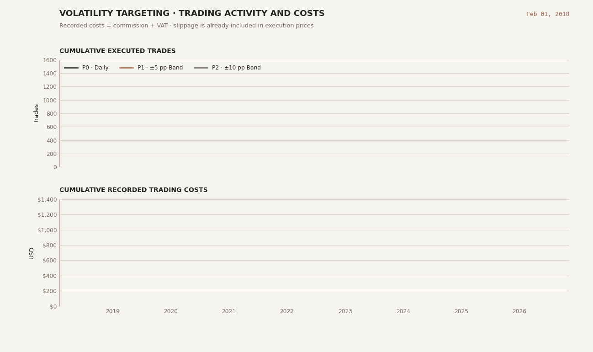
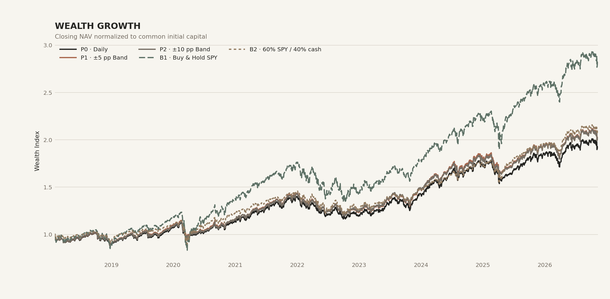
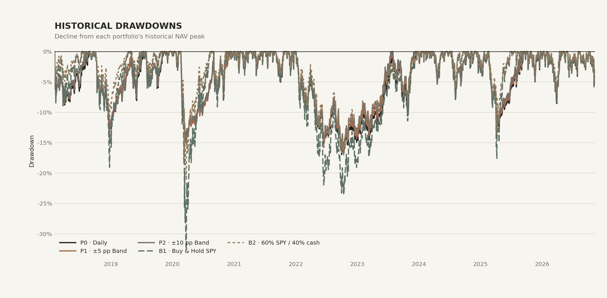

}}" hidden>

  <a href="https://github.com/ADRIANVM117/quant-research-notes/blob/main/volatility_target/01_rebalancing_policies/03_economic_statistic_evaluation.ipynb" target="_blank" rel="noopener noreferrer">
    
    Source NotebookGitHub
  </a>
  

In the previous installment, I built a backtesting engine capable of translating a volatility signal into simulated decisions, orders, and positions. It was a necessary step before comparing investment policies: a strategy depends not only on its exposure rule, but also on how it is executed and the frictions it faces.

With that infrastructure in place, the next question is more economic than mechanical: **what happens when different policies use the same signal but rebalance at different frequencies?**

Rebalancing bands appear attractive because they can reduce trading activity. However, trading less does not guarantee better outcomes. Less activity may mean lower costs, but it may also leave a portfolio further away from its desired exposure.

In this installment, I compare three policies built on the same EWMA signal. The goal is not to declare a winner, but to understand the economic consequences of their decisions when they are evaluated under consistent accounting rules.

{#fig-vt03-cumulative-costs fig-alt="GIF showing cumulative executed trades and cumulative recorded trading costs for P0, P1, and P2 with a shared time cursor."}

The operational difference is evident. But to understand its real significance, I also need to examine wealth growth and the risks experienced along the way.

## 1. Five Portfolios Under a Consistent Accounting Framework

To evaluate the economic consequences of rebalancing, I compared five portfolios under a homogeneous accounting framework.

The first three use the same target-volatility signal:

- **P0 — Daily rebalancing:** attempts to move exposure toward the target weight in every session.
- **P1 — ±5 pp band:** rebalances when the effective-weight deviation exceeds five percentage points.
- **P2 — ±10 pp band:** allows larger deviations before intervening.

I also included two benchmarks: **B1, Buy & Hold SPY**, which maintains an initial full position in the asset, and **B2, 60% SPY / 40% cash**, which maintains its initial allocation without subsequent rebalancing.

These benchmarks provide economic reference points, but they do not pursue the same volatility target or necessarily assume equivalent risks.

All portfolios share the same calendar, initial capital, valuation currency, and consistent accounting conventions. Their investment rules differ, but the methodology used to record positions, dividends, cash, and costs is comparable.

The first thing I observed was a considerable operational divergence. **P0 executed 1,547 trades**, compared with **263 for P1** and **115 for P2**. Recorded costs also declined: from **USD 1,278.52** for P0 to **USD 263.00** and **USD 115.00**, respectively.

These costs correspond to commissions and VAT. Slippage also affects portfolio economics, but it is already incorporated in execution prices.

The initial interpretation favors bands: fewer trades and lower recorded costs. However, a policy can save on friction and still end with a less attractive wealth path. That is why I need to examine what happened to capital.

## 2. Trading Less Is Not Enough: Wealth Growth and Benchmarks

Reducing rebalancing frequency has an evident operational benefit, but the important question is what happens to the wealth being managed.

To investigate this, I built a wealth index for each portfolio using its net asset value (*NAV*) and the same initial-capital base. This makes it possible to observe how one unit of wealth would have evolved over the historical sample.

NAV incorporates positions, cash, dividends, and the economic effects of simulated execution. Therefore, there is no need to subtract costs again or reconstruct returns using adjusted prices alone.

{#fig-vt03-normalized-wealth fig-alt="Normalized wealth chart from NAV for P0, P1, P2, Buy & Hold SPY, and 60% SPY / 40% cash."}

The results show differences that cannot be explained by the number of trades alone. **P1 and P2 recorded slightly higher geometric growth than P0** in this sample. However, this does not identify how much of the difference comes from lower costs and how much from the different exposures held along the way.

I also observed that **Buy & Hold SPY ended with the highest cumulative wealth**. But its strategy was fundamentally different: maintaining market exposure without attempting to adjust to a 12% volatility target.

Comparing terminal capital alone could favor the alternative that assumed different risk. The 60% SPY / 40% cash benchmark provides another reference point, based on an initially moderate exposure that does not respond to changes in volatility.

These comparisons make it possible to study the economic consequences of each policy, but they leave an open question: **what losses and what volatility did we have to experience to obtain those outcomes?**

## 3. The Cost of Risk: Volatility and Drawdowns

Observing wealth growth is important, but it does not tell us how the journey unfolded. Two portfolios can end with similar outcomes while experiencing very different risks.

To study this dimension, I evaluated realized volatility and historical *drawdowns* for the five alternatives. The former summarizes observed return variability; the latter shows how far each portfolio fell from the highest level of wealth it had reached up to that point.

This distinction is especially relevant in volatility targeting. **Estimating risk and adjusting exposure to pursue a target does not guarantee that realized volatility will match it exactly.**

In the sample, **P0 recorded annualized realized volatility of 11.89%**, while P1 and P2 reached **11.77% and 11.81%**, respectively. All three were close to the 12% target, although this aggregate observation does not demonstrate that the bands provide the same degree of risk control over time.

I also found differences in maximum losses from a historical high: **−16.95% for P0, −16.32% for P1, and −16.05% for P2**.

{#fig-vt03-historical-drawdowns fig-alt="Historical drawdown chart for P0, P1, P2, Buy & Hold SPY, and 60% SPY / 40% cash."}

The chart reveals something terminal wealth does not show: a loss does not end when the market stops falling. As long as capital remains below its previous high, the portfolio continues through a recovery period.

In this research, the maximum-drawdown episodes of all five alternatives recovered within the sample. Even so, their differences in depth and duration show why risk should not be summarized solely by a terminal number.

P1 and P2 recorded slightly lower volatility and maximum drawdown than P0. These are interesting results, but **they still do not justify concluding that bands improve risk control**.

## 4. Lower Costs Do Not Necessarily Mean Better Decisions

This research began with a simple question: if three policies use the same volatility estimate, what changes when we allow their portfolios to rebalance at different frequencies?

The results show that bands can substantially reduce trading activity and implementation costs. In this sample, P1 and P2 also recorded slightly higher geometric growth and somewhat lower maximum drawdowns than P0.

However, **observing a favorable outcome is not the same as demonstrating that a policy is superior**.

Bands modify more than costs. They also change the exposures held along the way and how far a portfolio is allowed to move away from its desired allocation. Therefore, I cannot directly attribute differences in growth to savings in trading activity.

This evaluation allowed me to move from studying how a policy is executed to investigating its economic consequences. But it also made the next problem clear: **how much can we trust differences observed within a single historical path?**

In the next installment, I will study their statistical uncertainty, the stability of the results, and tracking of the volatility target.

Before choosing a policy for my Quant Desk, I need to distinguish what happened in the backtest from what I can actually infer from it.

  <a href="https://github.com/ADRIANVM117/quant-research-notes/blob/main/volatility_target/01_rebalancing_policies/03_economic_statistic_evaluation.ipynb" target="_blank" rel="noopener noreferrer">
    
    Source NotebookGitHub
  </a>
  

