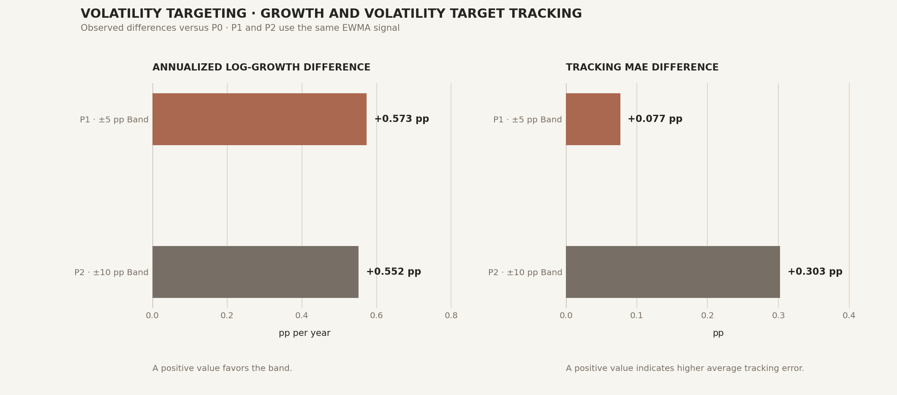
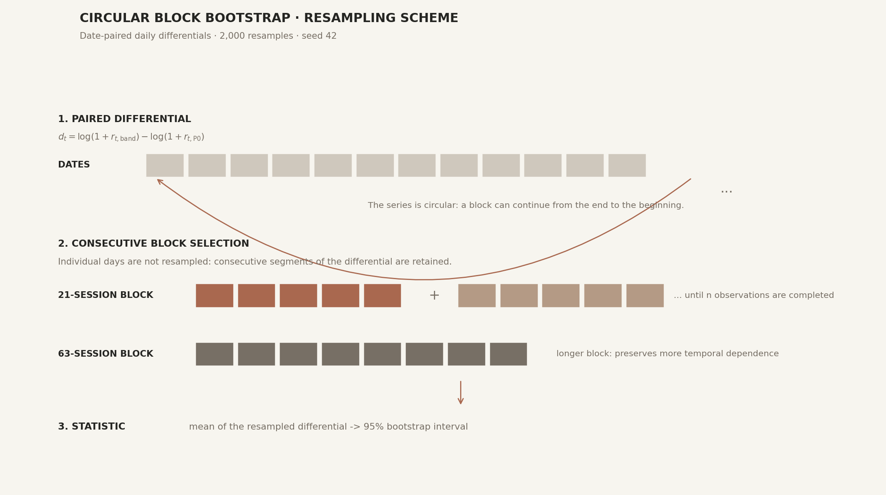
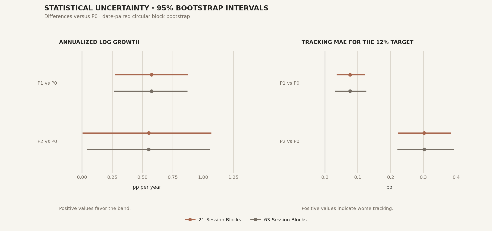

}}" hidden>

  <a href="https://github.com/ADRIANVM117/quant-research-notes/blob/main/volatility_target/01_rebalancing_policies/03_economic_statistic_evaluation.ipynb" target="_blank" rel="noopener noreferrer">
    
    Research NotebookGitHub
  </a>
  

In the previous installment, I evaluated the economic consequences of three rebalancing policies built on the same EWMA signal. The bands substantially reduced trading activity and costs, while their growth and risk outcomes showed relatively small differences from daily rebalancing.

Until that point, the research described what had happened along one historical path.

But a more difficult question emerged: **how much can we trust those differences before using them to make investment decisions?**

A favorable backtest result does not necessarily represent a persistent advantage. It may depend on the particular conditions of the period analyzed, market variability, or choices made during the development of the research itself.

In this installment, I examine the uncertainty around the observed differences and a second, equally important dimension: whether the bands preserved the risk control we were trying to achieve.

## 1. Two Results Pointing in Different Directions

The primary comparison in this research is P1, with a ±5 percentage-point band, against P0, which rebalances daily. P2, with a ±10 percentage-point band, is a secondary comparison.

To evaluate their potential contribution, I used two complementary metrics.

The first measures the **annualized log-growth differential**, constructed from daily portfolio returns. A positive value indicates greater observed growth relative to P0.

The second measures the **mean absolute error (MAE) in tracking the 12% volatility target**, using 21-session rolling windows. In this case, a positive differential means that the policy moved further away from the desired risk level.

This distinction reveals an important result: both bands recorded slightly higher log growth than P0, but also higher average tracking errors.

{#fig-vt04-growth-tracking fig-alt="Two panels compare P1 and P2 with P0: positive annualized log-growth differences and higher mean absolute volatility-target tracking error."}

Therefore, I am not simply looking for the policy that made the most money. I am examining whether the observed additional growth could justify the risk deviations we accepted.

## 2. Why Temporal Dependence Matters

One challenge when working with financial series is that observations are not always independent.

Although daily returns may exhibit little autocorrelation, their volatility is persistent. In addition, our tracking measures use overlapping 21-session rolling windows, which introduces dependence among consecutive observations.

To quantify uncertainty, I used a **date-paired circular block bootstrap**.

Rather than resampling isolated days, the procedure selects consecutive segments of the differentials between policies. This preserves part of the temporal structure and keeps comparisons aligned over the same market days.

I ran **2,000 resamples**, using 21-session blocks and a fixed seed to support reproducibility. I also repeated the analysis with 63-session blocks to assess how sensitive the intervals are to that methodological decision.

{#fig-vt04-circular-bootstrap fig-alt="Diagram of date-paired daily differentials, circular consecutive segments, and 21- and 63-session blocks used to estimate bootstrap intervals."}

The method does not create new independent historical periods. Its intervals quantify uncertainty under the resampling assumptions and within the sample studied; they do not remove the limitations of having used these data earlier in model development.

## 3. What Do Confidence Intervals Really Tell Us?

Observed annualized log growth favored both bands relative to P0.

For P1, the differential was **+0.573 percentage points**, with a 95% bootstrap interval of **[0.275, 0.874]** using 21-session blocks.

P2 recorded **+0.552 percentage points**, with an interval of **[0.005, 1.067]**.

Both intervals lay above zero, although P2's lower bound was particularly close to it.

These results provide evidence favorable to incremental growth within the retrospective framework used. However, they do not demonstrate that the bands will retain that advantage in future data.

Block length is also one of the decisions that conditions our inference. That is why it is important to compare the results obtained with 21 and 63 sessions rather than presenting a single interval as a definitive conclusion.

And there is still the other side of the problem to examine: **if a policy showed higher growth, what happened to its ability to track the risk target?**

## 4. A Statistically Detectable Deterioration Does Not Establish Its Economic Significance

The volatility target was 12% annually. To evaluate tracking, I calculated each portfolio's realized volatility with 21-session rolling windows and measured its absolute distance from that target.

Relative to P0, mean error increased by **0.077 percentage points for P1** and **0.303 percentage points for P2**.

The bootstrap intervals for the MAE differential remained above zero for both policies and both block lengths. This strengthens the retrospective evidence of greater tracking error, but does not by itself establish whether that deterioration is economically acceptable.

These differences indicate lower average tracking precision in the sample, but they do not by themselves determine whether the deterioration is economically acceptable.

{#fig-vt04-bootstrap-intervals fig-alt="Two panels with point estimates and 95% bootstrap intervals for P1 and P2 versus P0 under 21- and 63-session blocks, for growth and tracking MAE."}

Here a fundamental statistical distinction arises: **an interval that includes zero does not demonstrate that two policies are equivalent**.

To claim that a band keeps risk control sufficiently close to P0, we would need to define in advance how much deterioration we are willing to accept and formally assess that non-inferiority condition.

I did not set that margin before observing the results. Therefore, it would not be correct to conclude retrospectively that the bands preserve risk without a material deterioration.

In addition, the 100% exposure cap can prevent the 12% target from being reached in certain periods, even when the policy follows its rules correctly.

Risk tracking needs to be interpreted in light of both rebalancing decisions and the constraints of the system itself.

## 5. A Research Candidate Is Not Yet a Validated Strategy

The conclusion of this first stage of Volatility Targeting is more nuanced than it would appear from looking only at trades and costs.

The rebalancing bands reduced operational friction and showed positive log-growth differentials in the sample. At the same time, they tolerated larger errors in tracking the volatility target.

The bootstrap made it possible to quantify part of the uncertainty around those differences, but **it did not turn retrospective research into independent out-of-sample validation**.

For now, I consider P1 and P2 candidates for further research, not policies authorized to trade real capital.

This distinction will matter in the next stage. As I introduce GARCH, it will not be enough to obtain apparently better volatility forecasts: I will need to investigate whether that improvement changes our exposure decisions and produces economic benefits that withstand rigorous evaluation.

**The next step is not to choose the backtest winner, but to improve the evidence used to make that decision.**

  <a href="https://github.com/ADRIANVM117/quant-research-notes/blob/main/volatility_target/01_rebalancing_policies/03_economic_statistic_evaluation.ipynb" target="_blank" rel="noopener noreferrer">
    
    Research NotebookGitHub
  </a>
  

