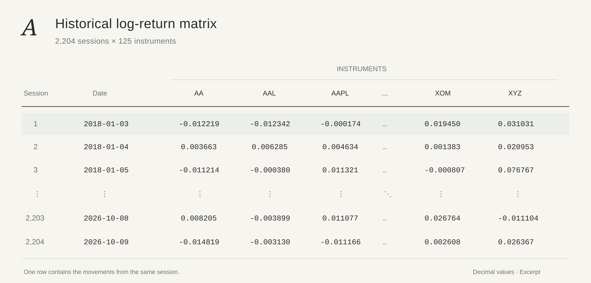
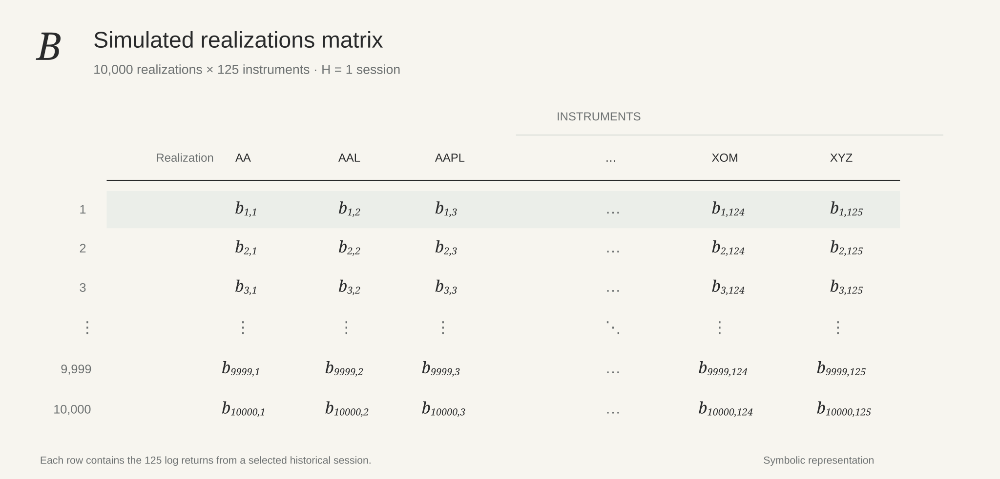
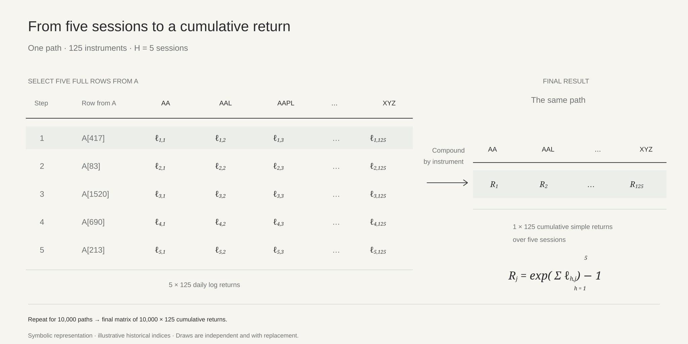
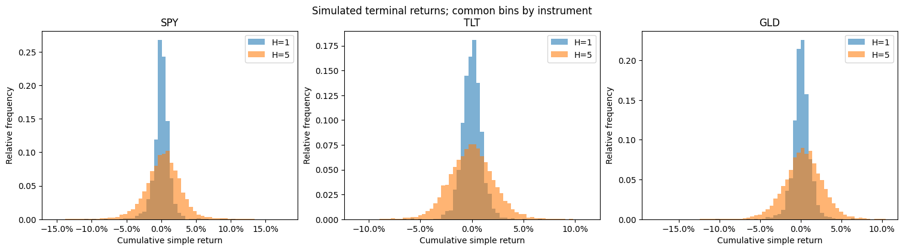
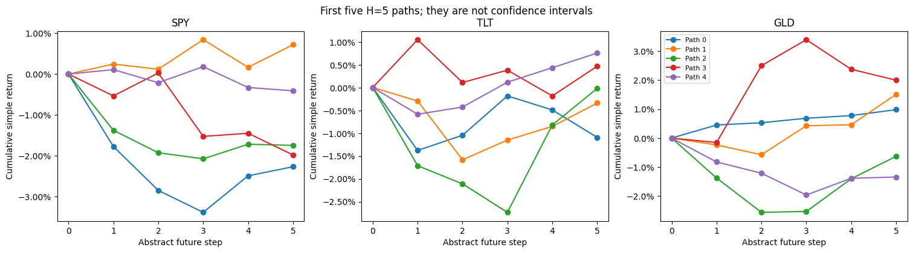
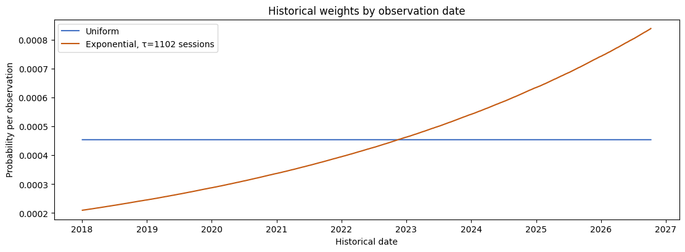
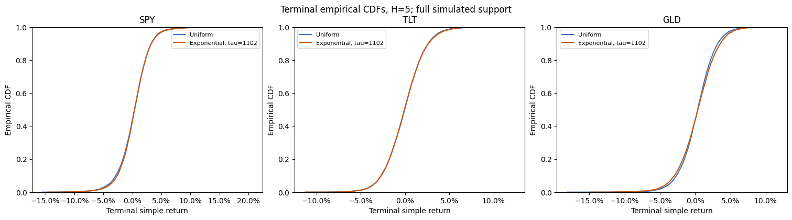

This is the first post I am publishing on my personal site, although the series began earlier on my [Substack](https://substack.com/@radian117). I therefore want to begin by briefly explaining what motivated me to write it.

The idea behind this series is to share the development of the portfolio engine I use day to day, explaining its components through notebooks built with real data. My aim is to share knowledge and explore methods that go beyond the classical mean-variance and Black-Litterman framework.

This work is inspired by the approach of [Anton Vorobets](https://antonvorobets.substack.com/) and, in particular, by his book **Portfolio Risk Management**.

In this installment, I work with historical data available through **October 9, 2026**. The aim is to understand how to generate scenarios, what changes when the weights of observations are modified, and how to interpret the resulting outputs.

The notebook for this installment is available [here](https://github.com/ADRIANVM117/data-science-portfolio/blob/main/scenario-portfolio-lab/notebooks/03_joint_resampling.ipynb), together with the rest of the series notebooks in my [GitHub](https://github.com/ADRIANVM117/data-science-portfolio/tree/main/scenario-portfolio-lab) repository.

## Starting point: matrix A

Let us begin with the input data. I will call **A** a matrix of **2,204 historical sessions × 125 instruments**. Its values are returns calculated from real adjusted prices: each row corresponds to one historical session and each column to one instrument.

Reading a complete row of **A** means observing how the 125 instruments moved during the same market session.

{#fig-matriz-a fig-alt="Matrix of real historical returns with 2,204 sessions and 125 instruments."}

This matrix will be the starting point for generating possible movements under a very simple model. To produce a one-session realization, I randomly select a complete row from **A**. Initially, every historical session has the same probability of being selected, namely (1/2204).

Sampling is performed **with replacement**: after each selection, every row remains available, so the same observation may appear multiple times.

Selecting the complete row preserves the simultaneous movements observed historically. If, on a given date, **SPY** fell while **TLT** and **GLD** rose, that combination is recovered together. If instead we drew each instrument separately, we would break the historical correspondence across assets.

I repeat this procedure **10,000 times**. The result is a new matrix **B** of **10,000 realizations × 125 instruments**, where each row represents one possible joint movement over a session under this model.

In **A**, every row corresponds to a historical date. In **B**, every row corresponds to a simulated realization; the original date remains as a reference for the origin of those returns.

{#fig-matriz-b fig-alt="Matrix of 10,000 simulated scenarios by 125 instruments."}

When this distribution is used to represent a future session, the assumption is that the historical sample, with uniform weights, is an appropriate reference. Generating these realizations makes it possible to study the implications of that assumption. Its predictive ability, however, is a different question and requires subsequent evaluation.

## 2. From one session to a five-session path

So far, each realization represented the joint movement of a single session. To extend the horizon, I constructed **five-session** paths.

For each path, the procedure selects **five historical sessions independently**, always retrieving the **125 instruments** jointly at every step. I repeated this process until obtaining **10,000 paths**.

Once each path was formed, I summed the **log returns** of every instrument over the five sessions and then converted them to **cumulative simple returns**. The result is a new distribution of **10,000 five-session outcomes per instrument**.

The difference from the previous case is that each path now combines real movements in a sequence that did not necessarily occur in that order historically. In that sense, the procedure preserves cross-sectional dependence within each session, but **assumes independence across the steps of the path**.

{#fig-cinco-sesiones fig-alt="Five historical selections form a path of cumulative returns by instrument."}

## 3. How are the results distributed?

Using the cumulative returns, I constructed the **terminal distributions** and compared the **one-** and **five-session** horizons. To illustrate them, I used **SPY, TLT, and GLD**.

For **SPY**, the standard deviation of the simulated simple return increased from **1.22%** to **2.68%**, indicating that the five-session outcomes were more dispersed.

The histograms show how the distribution of the **10,000 terminal outcomes** is allocated at each horizon.

{#fig-distribuciones fig-alt="Histograms of simulated terminal returns for SPY, TLT, and GLD over one- and five-session horizons."}

In addition to the final distribution, it is useful to observe the paths that lead to those outcomes. To do so, I selected five paths using **fixed identifiers**, rather than by their final value.

{#fig-trayectorias fig-alt="Five cumulative-return paths selected using fixed identifiers."}

Both charts describe the behavior of the model under this construction. Its predictive ability, however, has not yet been evaluated.

## 4. Giving more weight to recent history

Up to this point, every historical session had the same selection probability. I then introduced an **exponential weighting** scheme, in which more recent observations receive greater probability while older observations remain available.

I used a **half-life of 1,102 sessions**, under which the more recent half of the sample accounts for **66.67%** of total probability, compared with the **50%** it would receive under uniform weighting.

This change modifies how much each observation weighs in the sampling process, but it does not alter the model's basic mechanics: sessions are still selected with replacement, and the simulation still introduces no dependence across steps.

{#fig-ponderacion-exponencial fig-alt="Historical-session selection probabilities under exponential weighting, with more weight on recent observations."}

For now, the choice of this half-life is **illustrative**. It makes it possible to study how the simulated distribution changes when more importance is given to recent history, but it does not yet imply validation of predictive ability.

## 5. Comparing the two ways of weighting history

To compare the two schemes, I generated **five-session** paths using the same random numbers in both simulations. This makes it possible to pair the results and observe how they change when the selection probabilities of historical sessions are modified.

For **SPY**, the mean simulated cumulative simple return changed from **0.2833% with uniform weights** to **0.3517% with exponential weights**. Meanwhile, the standard deviation decreased from **2.6819% to 2.5897%**.

In this run, exponential weighting produced a distribution with a slightly higher mean and slightly lower dispersion.

{#fig-sec-5 fig-alt="Cumulative distributions of simulated five-session returns under uniform and exponential weighting."}

The observed difference combines the effect of reweighting history with the variability of the Monte Carlo simulation. Therefore, these results describe how the distribution changed under the chosen assumptions, but **do not demonstrate an improvement in the model's predictive ability**.

## 6. Separating model effects from simulation noise

Finally, I compared the means obtained through simulation with their **analytical expectations**, calculated directly under each weighting scheme.

The case of **TLT** shows why this distinction matters. In the simulations, the mean five-session cumulative return changed from **−0.0441% with uniform weights** to **−0.0334% with exponential weights**, which initially suggested an improvement.

However, the exact means under both models showed the opposite: they changed from **−0.0267% to −0.0583%**, respectively. In other words, once simulation noise was separated out, the effect of changing the weights had the **opposite sign** from that suggested by the Monte Carlo realizations.

| Measure | Uniform | Exponential |
| --- | ---: | ---: |
| Monte Carlo simulation | −0.0441% | −0.0334% |
| Analytical expectation | −0.0267% | −0.0583% |

: TLT — Mean cumulative return over five sessions {#tbl-tlt-comparison}

::: {.comparison-indicators}
::: {.comparison-indicator}
Simulated change

**+0.0107 pp**
:::
::: {.comparison-indicator}
Analytical change

**−0.0316 pp**
:::
:::

[pp = percentage points.]{.comparison-note}

This result illustrates an important limitation: **Monte Carlo noise can alter the interpretation of small differences**, even when the implementation is correct. For that reason, whenever possible, simulated estimates should be compared with analytical benchmarks from the model.

## Next steps

So far, selection probabilities remain fixed within each path, and the steps are generated independently.

In **notebook 04**, I will study **state conditioning**: how to describe the state of the market and use that information to construct conditional scenarios. This will be the next step in exploring mechanisms that can incorporate temporal dependence into the process.

The implementation, controls, and complete results for this installment are available in [notebook 03 on GitHub](https://github.com/ADRIANVM117/data-science-portfolio/blob/main/scenario-portfolio-lab/notebooks/03_joint_resampling.ipynb).
