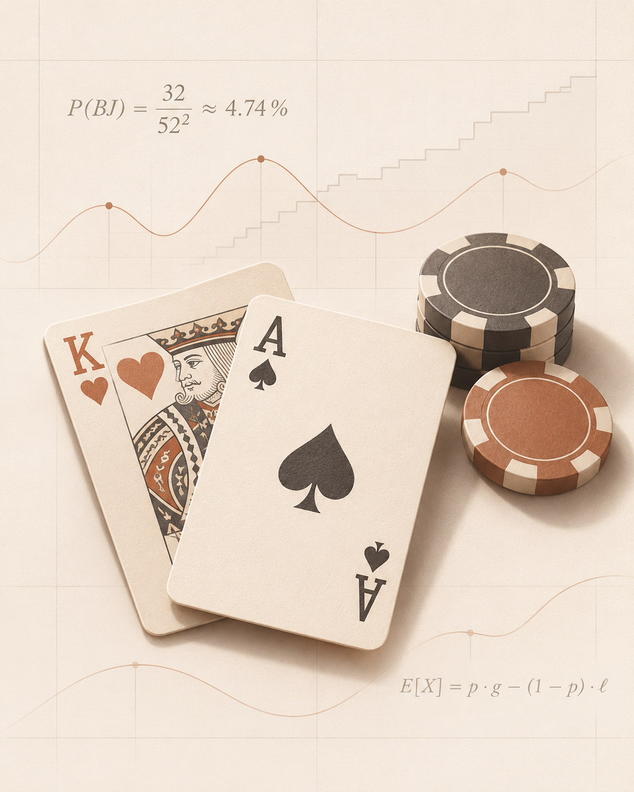

<style>#title-block-header{display:none}</style>

```{=html}
<div class="site-shell" data-language="en" data-page="writing"><style>.platform-links{display:flex;align-items:center;gap:18px;margin-left:2px}.platform-links a{display:inline-flex;opacity:.78;transition:opacity .18s ease}.platform-links a:hover{opacity:1}.platform-links a:focus-visible{outline:2px solid var(--accent);outline-offset:4px}.platform-links img{width:19px;height:19px;display:block}@media(max-width:720px){.platform-links{margin:5px 0 0;gap:20px}.platform-links img{width:20px;height:20px}}</style><header class="site-header"><a class="wordmark" href="../en/index.html">Adrián Vázquez<span class="wordmark-dot">.</span></a><button type="button" class="menu-toggle" aria-controls="main-nav" aria-expanded="false" aria-label="Toggle navigation">☰</button><nav id="main-nav" class="navigation" aria-label="Primary navigation"><a class="navlink " href="../en/index.html">Home</a><a class="navlink " href="../en/research.html">Research</a><a class="navlink " href="../en/projects.html">Projects</a><a class="navlink current" href="../en/writing.html">Writing</a><a class="navlink " href="../en/about.html">About</a><a class="navlink " href="../en/cv.html">CV & Contact</a><div class="platform-links" aria-label="Professional platforms"><a href="https://github.com/ADRIANVM117" target="_blank" rel="noopener noreferrer" aria-label="GitHub — Adrián Vázquez"></a><a href="https://www.linkedin.com/in/adrián-vazquez-1a90a01b6" target="_blank" rel="noopener noreferrer" aria-label="LinkedIn — Adrián Vázquez"></a><a href="https://substack.com/@radian117" target="_blank" rel="noopener noreferrer" aria-label="Substack — Adrián Vázquez"></a><a href="https://medium.com/@doromenoharris0" target="_blank" rel="noopener noreferrer" aria-label="Medium — Adrián Vázquez"></a></div></nav><div class="language-switch" aria-label="Language"><a href="../en/writing.html" lang="en" class="active">EN</a><span>/</span><a href="../es/writing.html" lang="es" class="">ES</a></div></header><main class="inner-main"><section class="page-intro"><div class="micro">ADRIÁN VÁZQUEZ / WRITING</div><h1>Writing<span class="period">.</span></h1><p>A space for essays, notes, and research diaries.</p></section><section class="content-section"><div class="section-heading"><span class="micro section-number">01 / Notes & writing</span><span class="section-rule"></span><span class="micro right-label">WRITING</span></div><div class="writing-feature"><article class="writing-item writing-feature-copy"><div class="micro muted">01 / ESSAY</div><h3><a class="no-external" href="writing/ganaste_pero_que_demuestra.html">You Won. But What Does It Prove?</a></h3><p>On blackjack, winning streaks, and our tendency to mistake outcomes for skill.</p><a class="end-link" href="writing/ganaste_pero_que_demuestra.html">Read essay ↗</a></article><div class="writing-feature-art"></div></div></section></main><footer class="site-footer"><div><span class="footer-name">Adrián Vázquez.</span><p class="micro">Research, projects and notes in progress.</p></div><span class="footer-symbol">∴</span></footer></div><script src="../assets/site.js"></script>
```
