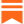

```{=html}
<div class="site-shell" data-language="es" data-page="cv"><style>.platform-links{display:flex;align-items:center;gap:18px;margin-left:2px}.platform-links a{display:inline-flex;opacity:.78;transition:opacity .18s ease}.platform-links a:hover{opacity:1}.platform-links a:focus-visible{outline:2px solid var(--accent);outline-offset:4px}.platform-links img{width:19px;height:19px;display:block}@media(max-width:720px){.platform-links{margin:5px 0 0;gap:20px}.platform-links img{width:20px;height:20px}}</style><header class="site-header"><a class="wordmark" href="../es/index.html">Adrián Vázquez<span class="wordmark-dot">.</span></a><button type="button" class="menu-toggle" aria-controls="main-nav" aria-expanded="false" aria-label="Toggle navigation">☰</button><nav id="main-nav" class="navigation" aria-label="Primary navigation"><a class="navlink " href="../es/index.html">Inicio</a><a class="navlink " href="../es/research.html">Investigación</a><a class="navlink " href="../es/projects.html">Proyectos</a><a class="navlink " href="../es/writing.html">Escritura</a><a class="navlink " href="../es/about.html">Sobre mí</a><a class="navlink current" href="../es/cv.html">CV y contacto</a><div class="platform-links" aria-label="Professional platforms"><a href="https://github.com/ADRIANVM117" target="_blank" rel="noopener noreferrer" aria-label="GitHub — Adrián Vázquez"></a><a href="https://www.linkedin.com/in/adrián-vazquez-1a90a01b6" target="_blank" rel="noopener noreferrer" aria-label="LinkedIn — Adrián Vázquez"></a><a href="https://substack.com/@radian117" target="_blank" rel="noopener noreferrer" aria-label="Substack — Adrián Vázquez"></a><a href="https://medium.com/@doromenoharris0" target="_blank" rel="noopener noreferrer" aria-label="Medium — Adrián Vázquez"></a></div></nav><div class="language-switch" aria-label="Language"><a href="../en/cv.html" lang="en" class="">EN</a><span>/</span><a href="../es/cv.html" lang="es" class="active">ES</a></div></header><style>.cv-intro{max-width:none;display:grid;grid-template-columns:minmax(0,1fr) 230px;gap:8%;align-items:end}.cv-portrait{width:100%;margin:0;justify-self:end}.cv-portrait img{display:block;width:100%;aspect-ratio:4/5;object-fit:cover;object-position:50% 43%;border:1px solid var(--line)}@media(max-width:720px){.cv-intro{grid-template-columns:1fr;gap:20px}.cv-portrait{width:180px;justify-self:start}}</style><main class="inner-main"><section class="page-intro cv-intro"><div class="cv-intro-copy"><div class="micro">ADRIÁN VÁZQUEZ / CV</div><h1>CV<span class="period">.</span></h1><p>Trayectoria profesional, formación académica y práctica técnica en ciencia de datos cuantitativa y servicios financieros.</p></div><figure class="cv-portrait"></figure></section><section class="content-section"><section class="content-section"><div class="section-heading"><span class="micro section-number">01 / Experiencia profesional</span><span class="section-rule"></span><span class="micro right-label">SERVICIOS FINANCIEROS</span></div><div class="two-column-prose"><h2>Científico de Datos Cuantitativo<br>Modelado de Riesgo de Crédito</h2><div><p class="micro muted">MIFEL · MÉXICO · NOV 2025 — AGO 2026</p><p>Diseñó la primera arquitectura end-to-end de trazabilidad de clientes de Mifel, integrando datos de originación, buró y sociodemográficos en un conjunto unificado a nivel cliente para modelado de riesgo, monitoreo de portafolio y decisiones crediticias.</p><p>Desarrolló el primer motor interno de scoring para originación de tarjetas de crédito con XGBoost y Random Forest; evaluó miles de configuraciones mediante validación cruzada y mejoró la discriminación de riesgo en aproximadamente 10 puntos Gini frente a los modelos base.</p><p>Colaboró con ingeniería en una API de scoring en producción para decisiones en tiempo real; aplicó reject inference, desarrolló variables longitudinales de comportamiento y automatizó snapshots mensuales y pipelines de monitoreo, reduciendo en aproximadamente 50% el esfuerzo manual de reporteo.</p><p>Desarrolló marcos de validación por cohortes e implementó explicabilidad con SHAP para respaldar el monitoreo de modelos y las actualizaciones de políticas de aprobación.</p></div></div></section><section class="content-section"><div class="two-column-prose"><h2>Asociado de Ciencia de Datos</h2><div><p class="micro muted">GRUPO SALINAS / TREND IT · MÉXICO · MAR 2025 — NOV 2025</p><p>Diseñó y llevó a producción flujos analíticos en Google Cloud Platform para conjuntos de datos financieros y comerciales a gran escala.</p><p>Construyó un motor híbrido de recomendación que combinó embeddings de Word2Vec, recuperación por similitud, lógica de ranking y restricciones de negocio; se evaluó con NDCG@K y Recall@K.</p><p>Construyó pipelines de pronóstico de series de tiempo con reentrenamiento automatizado y monitoreo de drift, e implementó un asistente analítico de lenguaje natural integrado con BigQuery y LookerML.</p><p>Automatizó flujos de análisis y reporteo de campañas, reduciendo el esfuerzo operativo manual en más de 80% y mejorando la reproducibilidad y auditabilidad.</p></div></div></section><section class="content-section"><div class="two-column-prose"><h2>Programa Future Ready<br>Oracle Finance</h2><div><p class="micro muted">PWC MÉXICO · MÉXICO · AGO 2024 — ENE 2025</p><p>Contribuyó a implementaciones de Oracle Cloud Finance, apoyando la estandarización de procesos, flujos de datos estructurados y automatización relacionada con finanzas.</p><p>Apoyó la automatización de procesos mediante scripting, consultas estructuradas y validación de datos operativos.</p></div></div></section><section class="content-section"><div class="two-column-prose"><h2>Becario del Departamento de Riesgos</h2><div><p class="micro muted">ASOCIACIÓN MEXICANA DE INSTITUCIONES DE SEGUROS (AMIS) · MÉXICO · JUL 2023 — FEB 2024</p><p>Automatizó procesos de generación de reportes de riesgo en Python, reduciendo el tiempo de generación en 40%.</p><p>Estandarizó la lógica de reportes SQL para indicadores internos de riesgo y resultados de monitoreo.</p></div></div></section><style>.cv-list{border-top:1px solid var(--line)}.cv-list>div{padding:18px 0;border-bottom:1px solid var(--line)}.cv-list strong{font:16px Georgia,serif;font-weight:normal}.cv-list p{margin:7px 0 0;font:15px/1.65 Georgia,serif;color:var(--body)}.credential-link{display:inline-block;margin-top:8px;font:11px 'DM Mono',monospace;border-bottom:1px solid var(--line);padding-bottom:4px}.social-list{border-top:1px solid var(--line)}.social-link{display:grid;grid-template-columns:30px 1fr auto;gap:16px;align-items:center;padding:17px 0;border-bottom:1px solid var(--line)}.social-link img{width:22px;height:22px}.social-link strong{font:16px Georgia,serif;font-weight:normal}.social-link span{font:12px 'DM Mono',monospace;color:var(--muted)}.social-link em{font:13px 'DM Mono',monospace;font-style:normal}@media(max-width:720px){.social-link{grid-template-columns:30px 1fr}.social-link em{display:none}}</style><style>.social-link{grid-template-columns:38px minmax(0,1fr) auto;column-gap:22px}.social-link img{width:24px;height:24px}.social-link div{display:grid;gap:5px;align-content:center}.social-link strong,.social-link span{display:block}.social-link strong{line-height:1.2}.social-link span{line-height:1.35}.social-link em{justify-self:end;padding-left:12px}@media(max-width:720px){.social-link{grid-template-columns:38px minmax(0,1fr);column-gap:16px}}</style><section class="content-section"><div class="section-heading"><span class="micro section-number">02 / Educación</span><span class="section-rule"></span><span class="micro right-label">FORMACIÓN ACADÉMICA</span></div><div class="two-column-prose"><h2>Licenciatura en Actuaría</h2><div><p class="micro muted">UNIVERSIDAD LA SALLE · MÉXICO</p><p>Una formación matemática en probabilidad, estadística, procesos estocásticos, matemáticas financieras, derivados, opciones y modelado de riesgo.</p></div></div></section><section class="content-section"><div class="section-heading"><span class="micro section-number">03 / Experiencia técnica e idiomas</span><span class="section-rule"></span><span class="micro right-label">HERRAMIENTAS / MÉTODOS</span></div><div class="two-column-prose"><h2>Experiencia técnica</h2><div class="cv-list"><div><strong>Programación e ingeniería de datos</strong><p>Python, SQL, R, C++; pipelines de datos, ingeniería de variables, analítica en la nube e integración de modelos en producción.</p></div><div><strong>Machine learning y modelado estadístico</strong><p>Ensemble learning, validación cruzada, selección de modelos, reject inference, explicabilidad (SHAP), aprendizaje de representaciones, sistemas de ranking y pronóstico de series de tiempo.</p></div><div><strong>Finanzas cuantitativas y riesgo</strong><p>Simulación Monte Carlo, procesos estocásticos, optimización de portafolios, modelado de factores, backtesting, análisis de escenarios, VaR, CVaR, pruebas de estrés y riesgo de crédito.</p></div><div><strong>Librerías y plataformas</strong><p>NumPy, pandas, scikit-learn, Statsmodels, TensorFlow, Keras, PyMC, QuantLib, Git, Jupyter, AWS, Google Cloud Platform, BigQuery y Vertex AI.</p></div><div><strong>Idiomas</strong><p>Español — Nativo<br>Inglés — B2</p></div></div></div></section><section class="content-section"><div class="section-heading"><span class="micro section-number">04 / Formación adicional</span><span class="section-rule"></span><span class="micro right-label">EDUCACIÓN CONTINUA</span></div><div class="two-column-prose"><h2>Programas y credenciales</h2><div class="cv-list"><div><strong>Deep Learning para Finanzas</strong><p>Colegio de Matemáticas Bourbaki</p><a class="credential-link" href="https://www.colegio-bourbaki.com/diploma/adrian-vazquez-mora-uibq5">Ver credencial ↗</a></div><div><strong>Métodos Matemáticos para Finanzas Cuantitativas</strong><p>MITx · En curso</p></div><div><strong>Procesos Estocásticos para Finanzas</strong><p>Asociación Mexicana de Actuarios (AMAT)</p></div><div><strong>Procesamiento Avanzado de Lenguaje Natural</strong><p>Colegio de Matemáticas Bourbaki</p><a class="credential-link" href="https://www.colegio-bourbaki.com/diploma/adrian-vazquez-mora-ybs5w21">Ver credencial ↗</a></div><div><strong>Aplicaciones Financieras de Machine Learning & AI</strong><p>Colegio de Matemáticas Bourbaki</p><a class="credential-link" href="https://www.colegio-bourbaki.com/diploma/adrian-vazquez-mora">Ver credencial ↗</a></div><div><strong>Ciencia de Datos & Machine Learning para Científicos de Datos</strong><p>Tecnológico de Monterrey</p><a class="credential-link" href="https://www.credential.net/8544ec6a-d347-464a-bfd3-8ae528607f7a#acc.iIa8WvhS">Ver credencial ↗</a></div><div><strong>Fundamentos de Machine Learning de AWS Academy</strong><p>AWS Academy</p><a class="credential-link" href="https://www.credly.com/badges/744f8685-d167-4bf7-ac6c-8818d64b8570/public_url">Ver credencial ↗</a></div><div><strong>Asociado de Datos en Python</strong><p>DataCamp</p><a class="credential-link" href="https://www.datacamp.com/certificate/PDA0016858828375">Ver credencial ↗</a></div></div></div></section><section class="content-section"><div class="section-heading"><span class="micro section-number">05 / Enlaces y contacto</span><span class="section-rule"></span><span class="micro right-label">OTROS ESPACIOS</span></div><div class="two-column-prose"><h2>También en internet.</h2><div><p>Puedes encontrar mi trabajo, escritura y trayectoria profesional en estas plataformas.</p><div class="social-list"><a class="social-link" href="https://github.com/ADRIANVM117"><div><strong>GitHub</strong><span>Código y repositorios</span></div><em>↗</em></a><a class="social-link" href="https://www.linkedin.com/in/adrián-vazquez-1a90a01b6"><div><strong>LinkedIn</strong><span>Perfil profesional</span></div><em>↗</em></a><a class="social-link" href="https://substack.com/@radian117"><div><strong>Substack</strong><span>Escritura y ensayos</span></div><em>↗</em></a><a class="social-link" href="https://medium.com/@doromenoharris0"><div><strong>Medium</strong><span>Artículos y notas</span></div><em>↗</em></a></div></div></div></section><footer class="site-footer"><div><span class="footer-name">Adrián Vázquez.</span><p class="micro">Investigaciones, proyectos y notas en desarrollo.</p></div><span class="footer-symbol">∴</span></footer></div><script src="../assets/site.js"></script>
```
