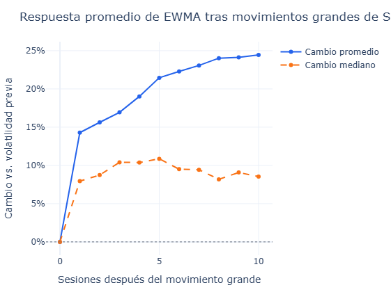
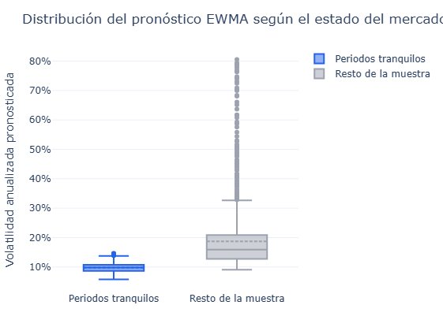

}}" hidden>

<a href="https://github.com/ADRIANVM117/quant-research-notes/tree/main/volatility_target/01_rebalancing_policies" target="_blank" rel="noopener noreferrer">Repositorio y documentación · GitHub</a>

---

## ¿Por qué comenzar con EWMA?

Cuando comencé a estudiar modelos de volatilidad, me resultaba atractivo avanzar hacia metodologías cada vez más sofisticadas: GARCH, modelos de volatilidad estocástica y, eventualmente, técnicas de aprendizaje automático.

Sin embargo, mientras desarrollaba los componentes de riesgo de mi propio Quant Desk, empecé a considerar una pregunta más importante: **¿qué necesito entender realmente sobre un modelo de volatilidad antes de utilizarlo para tomar decisiones de inversión?**

Un modelo puede estar correctamente implementado y comportarse como esperamos matemáticamente. Eso no significa necesariamente que pronostique bien el riesgo futuro. Y aunque sus pronósticos fueran útiles, todavía faltaría demostrar que incorporarlos a una estrategia genera valor económico.

Son tres preguntas diferentes, y considero importante no confundirlas.

Por eso decidí comenzar con un modelo relativamente sencillo: **Exponentially Weighted Moving Average (EWMA)**.

En esta primera entrega utilizo datos diarios reales de SPY para estudiar cómo evoluciona la estimación de volatilidad, cómo responde después de movimientos extremos y qué ocurre durante periodos relativamente tranquilos.

Mi intención no es demostrar que EWMA sea superior a otros modelos, sino entender qué información obtenemos de él, cuáles son sus limitaciones y qué preguntas debemos resolver antes de utilizar sus estimaciones para gestionar exposición y riesgo.

La implementación completa y los experimentos están disponibles en la notebook que acompaña esta publicación.

## Cuando el mercado se mueve violentamente

Una de las primeras preguntas que quise responder fue cómo cambia el riesgo estimado después de un movimiento extremo de mercado.

Utilizando datos diarios de SPY, identifiqué **112 sesiones** cuyos retornos absolutos superaron un umbral de **2.30%**, correspondiente al percentil 95 de la muestra histórica.

Tras estos movimientos, el pronóstico de volatilidad EWMA para la sesión siguiente aumentó, en promedio, **14.68% respecto a su nivel previo**.

Pero lo interesante no fue únicamente la reacción inmediata, sino lo que ocurrió después.

A cinco y diez sesiones, la volatilidad estimada permanecía por encima del nivel anterior al evento. En lugar de disiparse rápidamente, el riesgo estimado continuaba elevado durante los episodios de turbulencia.

Esto plantea una distinción importante: **EWMA tiene memoria por construcción, pero los mercados también pueden experimentar movimientos extremos consecutivos**. Cuando ambos fenómenos coinciden, el estimador puede permanecer elevado durante más tiempo del que sugeriría el efecto aislado de un único shock.

{#fig-ewma-shock-response fig-alt="Cambio porcentual medio y mediano de la volatilidad estimada por EWMA después de movimientos extremos de SPY."}

Otra observación fue la diferencia entre media y mediana: unos pocos episodios especialmente intensos elevaban considerablemente el promedio.

En otras palabras, EWMA no solo refleja el tamaño del último movimiento; su estimación también depende de la secuencia reciente de retornos.

Sin embargo, nada de esto demuestra todavía que anticipe correctamente la volatilidad futura. Lo que hemos observado es cómo responde el estimador ante la historia que acaba de recibir.

## ¿Qué sucede cuando el mercado está tranquilo?

Después de estudiar los movimientos extremos, quise observar el comportamiento contrario: ¿qué ocurre con EWMA cuando SPY atraviesa periodos de relativa calma?

Para identificarlos, utilicé ventanas de **20 sesiones** y calculé el promedio de los retornos absolutos. Clasifiqué como tranquilas aquellas observaciones situadas en el 25% inferior de esta medida, equivalente a un promedio diario de movimientos de **0.50% o menos**.

El resultado fue una diferencia considerable.

Durante las **553 sesiones tranquilas**, la mediana de volatilidad anualizada estimada por EWMA fue de **9.85%**, frente al **15.91%** observado en las otras 1,653 sesiones.

Pero la diferencia no estaba solamente en el nivel de volatilidad.

Durante los periodos tranquilos, las estimaciones estaban mucho más concentradas y la media era prácticamente idéntica a la mediana. En el resto de la muestra, la media superaba considerablemente a la mediana, reflejando la influencia de episodios de turbulencia.

{#fig-ewma-calm-periods fig-alt="Distribución de la volatilidad anualizada estimada por EWMA durante periodos tranquilos y el resto de las sesiones de SPY."}

Esto muestra cómo EWMA refleja diferentes condiciones históricas de riesgo: sus estimaciones son menores y menos dispersas cuando los movimientos recientes han sido contenidos, mientras que los episodios extremos pueden elevar sustancialmente la distribución.

Sin embargo, hay una distinción fundamental: **identificamos los periodos tranquilos utilizando los movimientos históricos observados, no mediante una predicción anticipada del modelo**.

Por tanto, encontramos una relación descriptiva coherente, pero todavía no hemos demostrado que EWMA permita anticipar cuándo comenzará o terminará un periodo de calma.

## Lo que EWMA todavía no ha demostrado

EWMA nos permitió entender cómo evoluciona el riesgo estimado, cómo responde a movimientos extremos y por qué puede permanecer elevado después de un shock.

Sin embargo, **todavía no hemos demostrado capacidad predictiva ni justificado que utilizar estas estimaciones genere valor económico**. Que un modelo funcione matemáticamente no significa que ayude a tomar mejores decisiones.

Antes de avanzar hacia GARCH o modelos más sofisticados, quiero explorar esa diferencia. En la siguiente entrega evaluaré **políticas de exposición y rebalanceo con bandas**, incorporando costos, restricciones y benchmarks para investigar si utilizar EWMA mejora la gestión del riesgo o los resultados de inversión.

Quizá descubramos que una política sencilla aporta más valor que un modelo complejo. O que, en determinadas condiciones, es mejor no intervenir.

---

*Los experimentos, cálculos y controles de esta entrega están disponibles en la notebook 01 de la serie Volatility Targeting.*

<a href="https://github.com/ADRIANVM117/quant-research-notes/tree/main/volatility_target/01_rebalancing_policies" target="_blank" rel="noopener noreferrer">Repositorio y documentación · GitHub</a>

