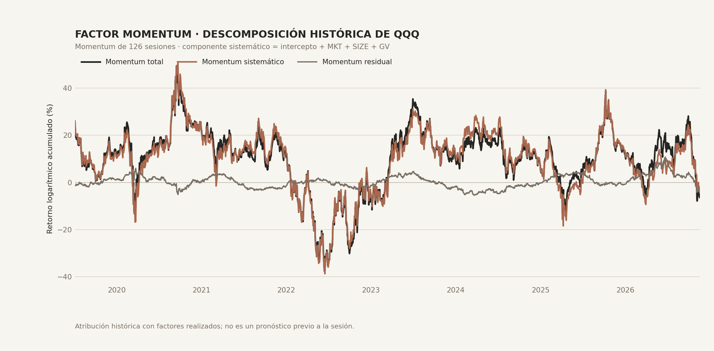
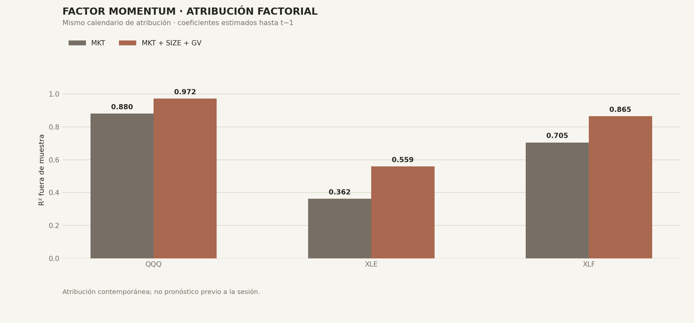
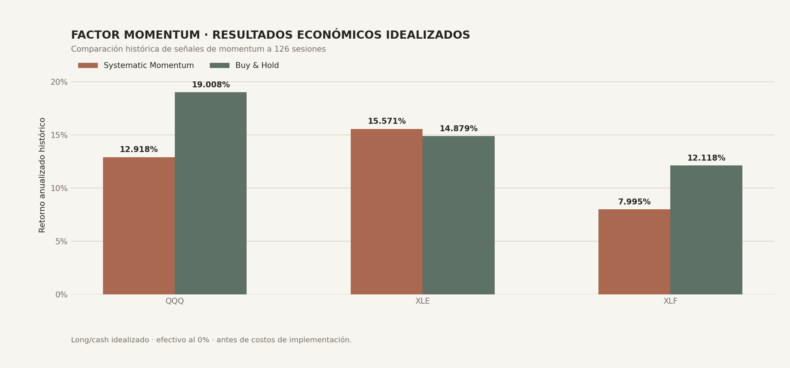

}}" hidden>

  <a href="https://github.com/ADRIANVM117/quant-research-notes/tree/main/Momentum_systematic_strategies/02_factor_momentum" target="_blank" rel="noopener noreferrer">Repositorio de investigaciónGitHub</a>
  
  

Un modelo puede explicar gran parte de las variaciones observadas de un activo y, aun así, no ayudarnos a construir una mejor estrategia de inversión.

Esta fue una de las contradicciones que encontré al investigar el momentum desde una perspectiva factorial.

En QQQ, un modelo que incorpora tres proxies sistemáticos alcanzó un R² de atribución de **0.972**. Sin embargo, cuando utilicé el componente sistemático para construir una señal de momentum, la estrategia obtuvo un retorno anualizado bruto del **12.918%**, frente al **19.008% de Buy & Hold** durante el mismo experimento idealizado.

¿Cómo puede un modelo explicar tan bien los retornos observados sin traducirse en una estrategia más rentable?

La respuesta comienza por reconocer que **explicar un retorno, anticipar su dirección y obtener un beneficio económico son problemas diferentes**.

Para investigarlo, estudié siete ETFs, construí una descomposición factorial de sus retornos y evalué si el momentum sistemático podía aportar información útil frente a señales más sencillas.

Mi objetivo no era encontrar el modelo con mayor R², sino comprender qué información capturaba y hasta dónde podía utilizarla para tomar decisiones de inversión.

## 1. Descomponer el retorno de un activo

Cuando observamos que un activo sube o baja, su movimiento no necesariamente responde a características exclusivas de ese instrumento.

Parte de su comportamiento puede estar relacionado con el mercado general, con diferencias entre empresas grandes y pequeñas o con la evolución relativa de compañías de crecimiento y valor.

Para estudiar esas relaciones utilicé siete ETFs: SPY, QQQ, IWM, IWD, IWF, XLE y XLF. A partir de sus retornos construí tres proxies factoriales:

- **MKT — Mercado:** representado por SPY.
- **SIZE — Tamaño relativo:** diferencia entre IWM y SPY.
- **GV — Crecimiento frente a valor:** diferencia entre IWF e IWD.

Estos proxies no son factores independientes ni perfectamente aislados. Son aproximaciones observables para estudiar movimientos comunes entre activos.

Mediante regresiones OLS rodantes de **252 sesiones**, estimé la sensibilidad histórica de cada ETF a estos componentes.

Los coeficientes se calculan utilizando información hasta la sesión anterior. Posteriormente, los factores observados al cierre permiten descomponer el retorno del día en un **componente sistemático**, que incluye el intercepto y las contribuciones factoriales, y un **componente residual**, correspondiente a lo no explicado por el modelo.

Esta distinción es fundamental: **atribuir un retorno después de observar los factores del día no equivale a haberlo pronosticado antes de la sesión**.

A continuación, utilicé ventanas de **126 sesiones** para estudiar el momentum acumulado de los componentes total, sistemático y residual.

{#fig-factor-momentum-decomposition fig-alt="Gráfica temporal de QQQ con momentum total, sistemático y residual de 126 sesiones, expresado como retorno logarítmico acumulado."}

Esta separación permite observar cómo se relaciona la tendencia histórica de un activo con los movimientos atribuidos a nuestros proxies.

Pero introduce otra pregunta: **¿explicar una mayor proporción de los retornos observados significa que hemos encontrado información más útil para anticipar el mercado?**

## 2. Cuando el modelo explica más, ¿qué hemos aprendido?

Para examinar cuánto aportaban los componentes adicionales, comparé dos especificaciones: una con el mercado como único proxy y otra que incorpora también SIZE y GV.

Los resultados mostraron mejoras importantes en el R² de atribución.

En **QQQ pasó de 0.880 a 0.972**; en **XLE, de 0.362 a 0.559**; y en **XLF, de 0.705 a 0.865**.

{#fig-factor-momentum-r2 fig-alt="Gráfica de barras que compara el R² de los modelos MKT y MKT más SIZE y GV para QQQ, XLE y XLF."}

El resultado de QQQ parece especialmente convincente: el modelo completo consigue explicar una proporción muy elevada de la variación de sus retornos diarios.

Sin embargo, **explicar el 97.2% de esa variación no significa anticipar el 97.2% de sus movimientos, ni que esa proporción de su momentum acumulado sea sistemática**.

Aunque las sensibilidades se estimaron con datos anteriores, el modelo necesita conocer los retornos efectivos de los proxies durante la sesión evaluada. Estamos midiendo atribución contemporánea, no precisión de un pronóstico disponible antes del movimiento.

También encontré que esta capacidad de atribución no fue estable. En XLE, el R² del modelo completo descendió a **0.284 durante 2023–2026**, considerablemente por debajo de su resultado agregado.

Esto sugiere que las relaciones entre el sector energético y nuestros proxies pueden cambiar bajo distintas condiciones de mercado.

La descomposición ayuda a comprender los retornos observados. Lo que todavía necesitamos investigar es si podemos convertirla en una decisión útil para la siguiente sesión.

## 3. Del retorno sistemático a una señal de momentum

Comprender el comportamiento histórico de un activo no es lo mismo que decidir cuánto invertir mañana.

Para estudiar esta segunda pregunta, construí una medida de momentum acumulado sobre **126 sesiones** a partir del componente sistemático.

Quería investigar si la persistencia de los movimientos atribuidos a factores comunes podía aportar información útil para decidir cuándo mantener exposición.

Con esa medida evalué una política **long/cash**: mantener exposición al activo cuando la señal lo indica y permanecer en efectivo cuando no lo hace.

Aquí la cronología es fundamental.

Los coeficientes factoriales utilizados para atribuir el retorno de cada sesión se estiman con información hasta el día anterior. Al cierre de \(t\), los factores realizados ya son observables y permiten actualizar el componente sistemático y su momentum.

**La posición decidida con esa información se aplica únicamente al retorno posterior, en \(t+1\).**

Esta separación evita utilizar el mismo retorno que intentamos evaluar para decidir retrospectivamente la posición.

Para estudiar si la descomposición aportaba algo adicional, comparé Systematic Momentum con tres referencias: momentum temporal tradicional (*TSMOM*), Market Momentum y Buy & Hold.

La evaluación utiliza retornos logarítmicos y supone que el efectivo no genera intereses. Se trata de un experimento idealizado, sin órdenes ejecutadas ni todas las fricciones de una operación real.

Respetar esta secuencia temporal es necesario para evaluar la señal, pero **evitar información futura no demuestra que exista capacidad predictiva**.

La siguiente pregunta es económica: ¿qué sucedió cuando aplicamos la misma metodología a distintos activos?

## 4. La evidencia no favorece a todos los activos

Los resultados fueron distintos según el activo.

En **QQQ**, Systematic Momentum obtuvo un retorno anualizado bruto del **12.918%**, frente al **19.008% de Buy & Hold**.

En **XLF**, la comparación también favoreció a la estrategia pasiva: **7.995% frente a 12.118%**.

XLE presentó un resultado diferente. Systematic Momentum alcanzó **15.571% anualizado**, ligeramente por encima del **14.879% de Buy & Hold** y considerablemente superior al **5.615% de TSMOM**.

{#fig-factor-momentum-performance fig-alt="Gráfica de barras con los retornos anualizados de Systematic Momentum y Buy and Hold para QQQ, XLE y XLF."}

Estos contrastes muestran que **una mejor atribución factorial no se tradujo en superioridad económica generalizada**.

También debemos recordar que Buy & Hold y las políticas long/cash mantienen exposiciones diferentes; comparar únicamente sus retornos no equivale a comparar estrategias con el mismo riesgo.

El caso de XLE merece mayor atención, pero también prudencia.

Al evaluar la asociación entre su momentum sistemático de 126 sesiones y los retornos futuros de 21 sesiones, encontré una correlación de Spearman cercana a **−0.016**. Esta relación monotónica prácticamente nula no proporciona, por sí sola, evidencia convincente de capacidad predictiva.

Además, la ventaja bruta de XLE frente a Buy & Hold resultó sensible a los costos.

Al incorporar una penalización ilustrativa de **10 puntos básicos por cambio de posición**, el retorno anualizado de Systematic Momentum disminuyó de **15.571% a 14.601%**, quedando por debajo del 14.879% de Buy & Hold.

Esta sensibilidad simplificada no reproduce órdenes, precios de ejecución ni todas las fricciones de una operación real.

Tampoco podemos atribuir la diferencia favorable de XLE a SIZE o GV de manera aislada: el experimento no identifica causalmente la contribución incremental de esos proxies a la estrategia.

Finalmente, **XLE fue seleccionada retrospectivamente después de examinar los resultados de varios activos**. Su comportamiento constituye una observación exploratoria, no una validación independiente de la hipótesis.

La señal merece investigarse con mayor profundidad, pero todavía no representa una ventaja de inversión demostrada.

## 5. De una explicación estadística a una candidata de inversión

Esta investigación comenzó preguntando cuánto del momentum de un activo podía relacionarse con movimientos sistemáticos del mercado.

La descomposición factorial permitió estudiar esas relaciones y mejorar considerablemente la atribución contemporánea de los retornos. Sin embargo, encontramos que **explicar mejor lo ocurrido no garantiza anticipar lo que vendrá después**.

Al transformar esa información en señales de inversión, obtuvimos resultados diferentes entre activos. QQQ y XLF no superaron a Buy & Hold en retorno anualizado bruto, mientras que XLE presentó una ventaja histórica modesta, sensible incluso a una penalización simplificada de costos.

Además, XLE fue seleccionada después de observar los resultados de varias alternativas. Por tanto, su comportamiento no constituye una validación independiente ni demuestra una ventaja predictiva persistente.

Pero esa incertidumbre no significa que debamos descartar inmediatamente la hipótesis. Significa que necesitamos someterla a una evaluación diferente.

Hasta aquí trabajé con señales long/cash y rendimientos idealizados. Todavía no había representado cómo esas decisiones se transformarían en órdenes, acciones enteras, efectivo disponible y operaciones sujetas a fricciones.

**En la siguiente entrega llevaré la señal de XLE a una simulación de ejecución**, incorporando precios de apertura, comisiones, deslizamiento y eventos corporativos, para investigar cómo cambian los resultados al pasar de una asignación teórica a una cartera simulada.

No será una demostración de rentabilidad futura ni una validación prospectiva de la señal. Será una evaluación adicional de sus límites económicos y operativos.

**Antes de preguntarme si una estrategia merece capital real, necesito comprender qué sucede cuando intento llevarla de una señal matemática a decisiones ejecutables.**

  <a href="https://github.com/ADRIANVM117/quant-research-notes/tree/main/Momentum_systematic_strategies/02_factor_momentum" target="_blank" rel="noopener noreferrer">Repositorio de investigaciónGitHub</a>
  
  

