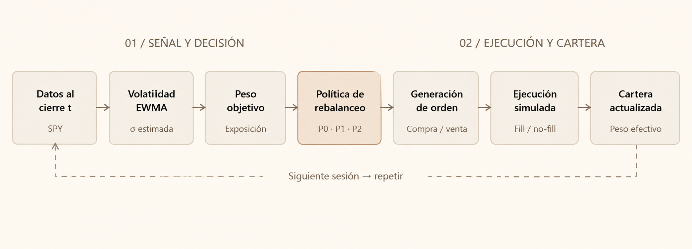
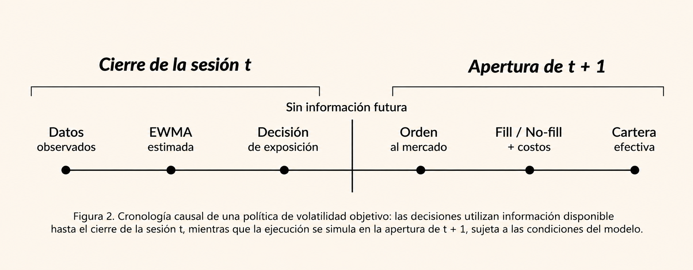
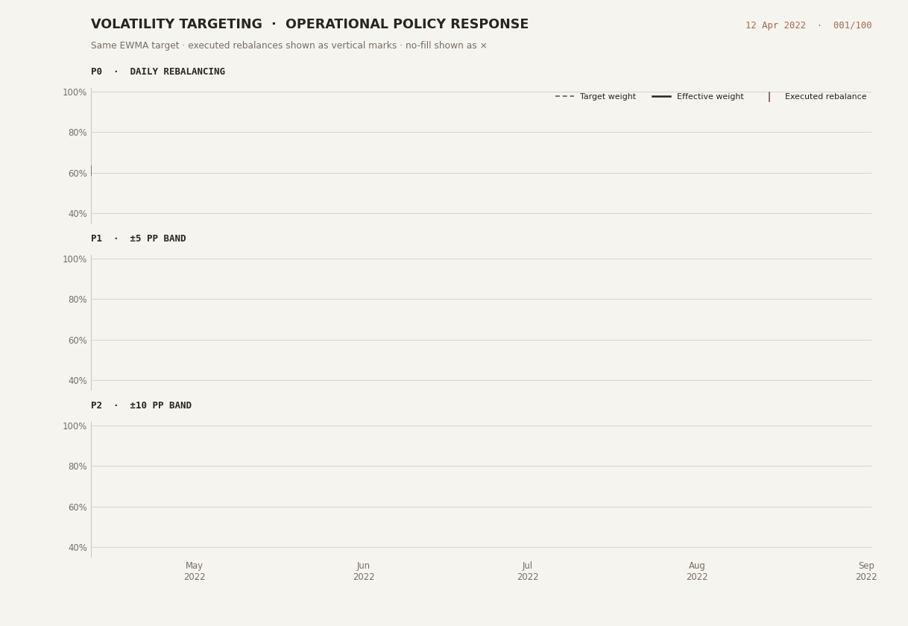

}}" hidden>

  <a href="https://github.com/ADRIANVM117/quant-research-notes/tree/main/volatility_target/01_rebalancing_policies" target="_blank" rel="noopener noreferrer">
    
    Repositorio y documentaciónGitHub
  </a>
  

En la primera entrega estudié cómo responde EWMA a los movimientos extremos y a los periodos de calma. El siguiente paso parecía sencillo: utilizar esa estimación para definir una exposición objetivo, aplicar bandas de rebalanceo y comparar políticas.

Sin embargo, apareció un problema más interesante.

**¿Cómo saber qué habría ocurrido realmente si hubiera intentado aplicar esas políticas en cada sesión histórica?**

Una señal calculada al cierre no equivale a una operación ejecutada. El mercado puede abrir a otro precio, una orden puede no ejecutarse, la cartera acumula dividendos y los costos afectan el capital disponible.

Lo que parecía una regla sencilla terminó convirtiéndose en un ejercicio de cronología, ejecución y contabilidad.

Esta entrega trata precisamente sobre eso: **qué significa construir un backtest que no utilice información del futuro y que represente, con supuestos explícitos, las decisiones que una estrategia habría podido tomar.**

## 1. De una señal a una decisión ejecutable

El primer paso fue transformar la estimación de EWMA en una exposición deseada.

Utilicé una regla de volatilidad objetivo del **12% anual** para determinar qué proporción del portafolio debería mantener en SPY. Cuando aumenta la volatilidad estimada, reduzco la exposición deseada; cuando disminuye, puedo aumentarla, sin superar el 100%.

La regla es sencilla:

$$
w^*_{t+1|t}=\min\left(1,\frac{0.12}{\widehat{\sigma}_{t+1|t}}\right)
$$

Pero aquí aparece una distinción importante: **el peso objetivo no es necesariamente el peso que mantiene mi cartera**.

La exposición efectiva también depende del movimiento del mercado, las posiciones existentes, el efectivo disponible y las operaciones realmente ejecutadas.

Por eso necesitaba algo más que una regla de asignación. Construí un motor que conecta la información disponible, las decisiones de rebalanceo, la preparación de órdenes, su ejecución simulada y la contabilidad de la cartera.

{#fig-vt02-backtest-engine fig-alt="Diagrama del flujo causal desde los datos al cierre y la volatilidad EWMA, al peso objetivo, la política de rebalanceo, la orden, la ejecución simulada y la cartera actualizada."}

El objetivo no era únicamente calcular cuánto debería invertir, sino representar qué habría ocurrido al intentar llevar esa decisión a la práctica.

## 2. El cierre de hoy no es la apertura de mañana

Uno de los primeros problemas que encontré fue la cronología. **Conocer una señal al cierre de una sesión no significa que pueda operar al mismo precio.**

En mi backtest, al cierre de $t$ observo los retornos, actualizo EWMA y calculo el peso objetivo. Con las posiciones y el efectivo disponibles, cada política decide si necesita rebalancear y prepara su orden.

La ejecución ocurre en la apertura de $t+1$, donde las condiciones pueden ser diferentes.

Para aproximarme a una implementación real, utilicé órdenes **Limit-on-Open (LOO)** para compras y **Market-on-Open (MOO)** para ventas. Una compra puede no ejecutarse si la apertura supera el precio límite; cuando se ejecuta, el motor incorpora comisiones y deslizamiento.

{#fig-vt02-causal-timeline fig-alt="Cronología entre el cierre de la sesión t y la apertura de t más uno, que separa datos observados, EWMA, decisión de exposición, orden, fill o no-fill, costos y cartera efectiva."}

Aquí comprendí que **una decisión correcta bajo la información disponible no garantiza alcanzar la exposición deseada**. Entre ambas cosas existen precios, órdenes, fricciones y restricciones que el backtest necesita representar.

Esto no convierte la simulación en una réplica perfecta del mercado: por ejemplo, asumir un llenado completo cuando una compra LOO cumple su límite sigue siendo una simplificación. Pero sí permite distinguir lo que habríamos decidido de lo que nuestro modelo supone que habríamos ejecutado.

## 3. Tres políticas, una misma señal, distintas decisiones

Una vez construido el motor, comparé tres políticas de rebalanceo utilizando exactamente la misma señal EWMA:

- **P0 — Rebalanceo diario:** busca ajustar la exposición hacia el peso objetivo cada sesión.
- **P1 — Banda de ±5 puntos porcentuales:** permite ciertas desviaciones antes de rebalancear.
- **P2 — Banda de ±10 puntos porcentuales:** tolera desviaciones mayores y, por tanto, puede operar con menor frecuencia.

La diferencia parece sencilla, pero sus consecuencias operativas son importantes: **tener el mismo peso objetivo no significa tomar las mismas decisiones ni terminar con la misma exposición efectiva**.

Para observarlo, seleccioné un periodo de 100 sesiones históricas, del 12 de abril al 2 de septiembre de 2022, utilizando un criterio basado en la actividad operativa y no en la rentabilidad de las políticas.

{#fig-vt02-policy-comparison fig-alt="Animación de 100 sesiones con tres paneles para P0, P1 y P2. Cada panel compara el peso objetivo y el peso efectivo, marca rebalanceos ejecutados y muestra un no-fill cuando corresponde."}

En este periodo, P1 ejecutó **11 rebalanceos**, mientras que P2 realizó **2**. También observamos una orden de P1 que no llegó a ejecutarse.

El GIF permite apreciar algo que una comparación de rendimientos no mostraría directamente: las bandas reducen la necesidad de intervenir, pero a cambio permiten que la cartera permanezca más alejada de la exposición deseada.

**Operar menos no significa necesariamente operar mejor.** Todavía necesitamos evaluar si los costos evitados compensan las desviaciones de riesgo que aceptamos.

## 4. Un backtest más realista no garantiza una estrategia rentable

Esta notebook me enseñó que construir una prueba retrospectiva creíble implica mucho más que aplicar una señal a una serie histórica de rendimientos.

Necesitamos distinguir qué información estaba disponible, qué decisiones podíamos tomar, qué órdenes habríamos intentado ejecutar y cómo esas operaciones afectarían realmente a nuestra cartera.

El motor incorpora estas diferencias mediante reglas de ejecución, costos, efectivo y restricciones. Sin embargo, sigue siendo una simulación con supuestos y simplificaciones; no una reproducción perfecta del mercado.

Y aquí aparece una distinción fundamental: **que una política opere menos no significa que gestione mejor el riesgo ni que produzca mejores resultados económicos**.

Por ahora, construimos un entorno para investigar esas preguntas, pero todavía no hemos justificado qué política aporta mayor valor.

El siguiente paso será evaluar las diferencias con métricas estadísticas y económicas, considerando el riesgo asumido, los costos y benchmarks relevantes.

**Antes de preguntarnos qué estrategia gana, necesitamos asegurarnos de que estamos comparando decisiones que realmente habríamos podido tomar.**

  <a href="https://github.com/ADRIANVM117/quant-research-notes/tree/main/volatility_target/01_rebalancing_policies" target="_blank" rel="noopener noreferrer">
    
    Repositorio y documentaciónGitHub
  </a>
  

