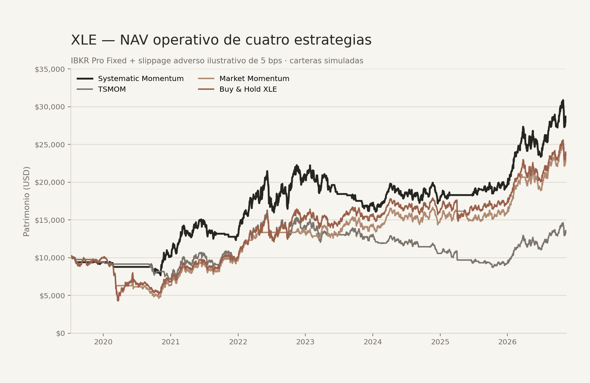

}}" hidden>

  <a href="https://github.com/ADRIANVM117/quant-research-notes/tree/main/Momentum_systematic_strategies/02_factor_momentum" target="_blank" rel="noopener noreferrer">Repositorio de investigaciónGitHub</a>
  
  

En la investigación anterior encontré que una señal de momentum sistemático aplicada a XLE producía resultados históricos interesantes, aunque sensibles a los costos.

Su retorno anualizado idealizado alcanzó el **15.571%**, ligeramente por encima del 14.879% de Buy & Hold. Sin embargo, esa diferencia desaparecía al incorporar una penalización simplificada de 10 puntos básicos por cambio de posición.

Además, XLE había sido seleccionada después de examinar otras alternativas. Sus resultados representaban una observación exploratoria, no evidencia independiente de una ventaja de inversión.

Pero todavía quedaba una pregunta más cercana a la práctica:

**¿Qué habría ocurrido si hubiera intentado transformar esas señales en órdenes y posiciones dentro de una cartera con capital limitado?**

Hasta entonces, la evaluación utilizaba una regla long/cash aplicada directamente a rendimientos posteriores. No necesitaba resolver cuántas acciones comprar, cuánto efectivo conservar o a qué precio habría intentado ejecutar cada decisión.

Para investigar esas diferencias, conservé la señal seleccionada de XLE y construí una simulación que incorpora precios de apertura, acciones enteras, efectivo, dividendos, eventos corporativos y fricciones operativas.

Mi objetivo no era demostrar rentabilidad futura, sino comprender **cómo cambia la evaluación económica cuando una señal teórica debe convertirse en una cartera simulada**.

## 1. De una señal a una cartera posible

Una señal long/cash parece sencilla: mantener exposición cuando el modelo lo indica y permanecer en efectivo cuando no.

Pero una decisión de inversión no se convierte automáticamente en una operación ejecutada.

En el experimento idealizado podía aplicar un peso a los rendimientos posteriores sin preocuparme por la cantidad de acciones, el efectivo disponible o las condiciones de apertura del mercado.

En una cartera, esas restricciones importan.

Partí de un capital inicial de **USD 10,000** y utilicé la misma especificación de señal investigada anteriormente, sin introducir una nueva regla para aprovechar los resultados observados.

En cada sesión, la decisión se determina con información disponible hasta el cierre de \(t\). Si corresponde cambiar la exposición, el simulador prepara la operación y evalúa su ejecución a la apertura de \(t+1\).

La cantidad de acciones se calcula bajo restricciones de capital y posiciones enteras. Las compras no pueden utilizar más efectivo del disponible, y la exposición efectivamente alcanzada puede diferir de la deseada.

La contabilidad también cambia. Los dividendos se acreditan como efectivo y los splits ajustan las posiciones. Además, el motor incorpora comisiones simuladas y supuestos explícitos de deslizamiento.

Esto introduce una distinción importante: **trabajar con precios ajustados por dividendos no es económicamente equivalente a recibir esos dividendos en efectivo dentro de una cartera que puede permanecer parcialmente desinvertida**.

Ambas metodologías responden preguntas diferentes.

La primera permite estudiar el comportamiento idealizado de una señal. La segunda representa cómo las decisiones habrían afectado las posiciones y el patrimonio bajo reglas operativas concretas.

Sin embargo, sigue siendo una simulación. Los precios históricos de apertura no contienen toda la información necesaria para reproducir una ejecución real: no observamos nuestra posición en la cola, la profundidad disponible ni los fills que habría recibido una orden específica.

El siguiente paso fue observar qué resultados producía esa contabilidad y cómo se comparaban distintas estrategias bajo las mismas convenciones operativas.

## 2. Una misma señal, resultados distintos

Una vez que la señal se convierte en una cartera simulada, la pregunta deja de ser únicamente si la regla parecía prometedora en términos idealizados.

Ahora necesitamos investigar **cómo habría evolucionado el patrimonio bajo condiciones explícitas de implementación**.

Para responderla, comparé cuatro alternativas aplicadas a XLE: Systematic Momentum, TSMOM, Market Momentum y Buy & Hold.

Todas se evaluaron con el mismo capital inicial de USD 10,000 y bajo un escenario operativo de referencia: **IBKR Pro Fixed + 5 puntos básicos de slippage adverso ilustrativo**.

Antes de observar el conjunto completo, conviene comparar las dos trayectorias que mejor representan el problema: Systematic Momentum y Buy & Hold.

{#fig-systematic-vs-buyhold-nav fig-alt="GIF animado que muestra la evolución cronológica del patrimonio simulado de Systematic Momentum y Buy & Hold sobre XLE bajo IBKR Pro Fixed y 5 bps de slippage adverso ilustrativo."}

La animación permite observar algo que una sola cifra no muestra: el resultado económico de una estrategia no depende únicamente de dónde termina, sino también de **cómo evoluciona el patrimonio durante el recorrido**.

En el escenario de referencia, Systematic Momentum terminó con **USD 28,028.02**, equivalente a un **CAGR de 15.046%**, un **Sharpe de 0.618** y un **drawdown máximo de −27.805%**.

Pero hay una distinción que no debemos perder de vista.

El CAGR operativo del 15.046% no representa simplemente el retorno idealizado de 15.571% después de descontar comisiones. Ambos experimentos utilizan convenciones diferentes de precios, dividendos, efectivo, posiciones y ejecución.

Por tanto, **su diferencia no identifica aisladamente el costo económico de operar**.

La siguiente comparación incorpora las cuatro estrategias bajo el mismo marco contable.

{#fig-xle-strategy-nav-comparison fig-alt="Gráfica temporal del NAV simulado de Systematic Momentum, TSMOM, Market Momentum y Buy & Hold sobre XLE bajo la misma convención operativa."}

Esta comparación resulta más informativa para estudiar las diferencias económicas dentro del simulador. Sin embargo, las estrategias mantienen exposiciones distintas y no necesariamente asumen el mismo riesgo.

Además, una trayectoria históricamente favorable no constituye por sí sola evidencia de que la estrategia conservará ese comportamiento en el futuro.

Para interpretar sus resultados necesitamos examinar también cuánto costó implementar sus decisiones.

## 3. El costo económico de operar

Una vez que las señales se convierten en órdenes simuladas, aparece una dimensión que el experimento idealizado no representaba completamente: las fricciones necesarias para modificar una cartera.

No todas las estrategias operan con la misma frecuencia.

Bajo el escenario de referencia, Systematic Momentum realizó **63 operaciones**, frente a 87 de TSMOM, 57 de Market Momentum y una compra inicial de Buy & Hold.

Pero contar operaciones no es suficiente para conocer su costo económico. También importa cuánto capital se negocia y a qué precio suponemos que podemos comprar o vender.

Para aproximar estas fricciones utilicé dos componentes: una estructura simulada de comisiones basada en **IBKR Pro Fixed** y un supuesto de **5 puntos básicos de deslizamiento adverso**.

En Systematic Momentum, la simulación registró **USD 68.23 en comisiones acumuladas** y un efecto estimado de **USD 455.95 por slippage** durante el periodo.

La distinción importa. Las comisiones son cargos explícitos de la simulación; el deslizamiento representa un deterioro supuesto respecto al precio de referencia y se incorpora en los precios de ejecución. No debemos descontarlo nuevamente del patrimonio final.

También debemos reconocer qué no estamos representando. El simulador no dispone de información histórica completa sobre diferenciales bid-ask, profundidad del libro, prioridad de órdenes o liquidez disponible en cada apertura.

Por tanto, **una operación simulada no equivale a un fill real obtenido a través de IBKR**.

La utilidad de este ejercicio no consiste en reproducir perfectamente el mercado, sino en hacer explícitas algunas de las fricciones que antes permanecían fuera del modelo.

Esto conduce a una pregunta más exigente: **si nuestros resultados dependen de supuestos sobre los precios de ejecución, ¿qué ocurre cuando esos supuestos se vuelven menos favorables?**

## 4. La fragilidad frente a las fricciones

Aunque incorporamos comisiones y precios históricos de apertura, todavía existe una incertidumbre importante: desconocemos el precio exacto al que nuestras órdenes habrían podido ejecutarse.

Por eso evalué cómo cambiaban los resultados al modificar el supuesto de deslizamiento adverso, manteniendo la misma estructura de comisiones.

En Systematic Momentum, el **CAGR simulado pasó de 15.536% sin slippage a 15.046% con 5 puntos básicos**. Al aumentar el supuesto a 10 y 20 puntos básicos, descendió a **14.583% y 13.590%**, respectivamente.

{#fig-xle-slippage-sensitivity fig-alt="Gráfica de barras del CAGR anualizado de XLE Systematic Momentum bajo supuestos de slippage adverso de 0, 5, 10 y 20 puntos básicos."}

La relación es clara: cuanto menos favorables suponemos los precios de ejecución, menor es el crecimiento del patrimonio.

Sin embargo, esta sensibilidad no estima cuánto slippage habría experimentado realmente la estrategia. Las condiciones de liquidez, los diferenciales y los movimientos alrededor de la apertura pueden diferir de los supuestos del modelo.

También estudié qué sucedía al **retrasar una sesión la ejecución** de las decisiones.

Bajo el escenario Fixed + 5 bps, el CAGR de Systematic Momentum disminuyó de **15.046% a 13.195%**.

El resultado muestra que el momento de ejecución puede modificar considerablemente la evaluación económica. Pero requiere una precisión: el experimento retrasado utiliza **1,852 sesiones en lugar de 1,853** y puede cruzar eventos corporativos.

Por tanto, no constituye una comparación perfectamente aislada del efecto de esperar un día.

Podemos observar sensibilidad a los supuestos sin concluir que hemos identificado causalmente el costo exacto de cada fricción.

**Una estrategia que parece atractiva bajo determinadas condiciones de ejecución necesita demostrar que sus resultados no dependen excesivamente de supuestos favorables.**

Y aun cuando una simulación supera estas pruebas, permanece otra pregunta: ¿cuánta evidencia estadística tenemos para confiar en sus diferencias frente a estrategias alternativas?

## 5. Una simulación favorable todavía no demuestra una ventaja de inversión

Hasta aquí, la señal de momentum sistemático de XLE mostró resultados históricos favorables bajo las reglas de ejecución simulada. Sin embargo, reproducir una cartera y obtener un resultado atractivo no significa que hayamos demostrado una ventaja persistente.

Para examinar la incertidumbre de las diferencias entre estrategias, utilicé un **bootstrap circular por bloques de 21 sesiones**, con 2,000 remuestreos.

En lugar de tratar cada rendimiento diario como una observación independiente, el procedimiento remuestrea segmentos consecutivos para conservar parte de la dependencia temporal.

Los resultados fueron distintos según la comparación. Frente a TSMOM, el diferencial de crecimiento logarítmico favoreció a Systematic Momentum en el **95.0% de las réplicas bootstrap**. Frente a Market Momentum, esa proporción fue del **72.6%**. Sin embargo, frente a Buy & Hold fue del **49.6%**, sin una ventaja clara bajo este procedimiento.

Estas proporciones describen los diferenciales dentro del remuestreo. **No representan probabilidades de que la estrategia supere a sus alternativas en el futuro.**

Existe además una limitación importante: el bootstrap utiliza los retornos idealizados de la investigación anterior, no el patrimonio neto del simulador de ejecución. Por tanto, no cuantifica directamente la incertidumbre de los resultados operativos presentados aquí.

Tampoco elimina el problema de selección. XLE fue elegida después de examinar otras alternativas sobre el mismo historial, y las evaluaciones posteriores continúan utilizando ese periodo.

Una simulación más detallada no transforma automáticamente los resultados en evidencia independiente.

¿Qué conseguimos entonces?

Construí un entorno donde una señal matemática puede convertirse en decisiones, órdenes, posiciones y una contabilidad coherente. Pude evaluar su sensibilidad a las condiciones de ejecución e identificar restricciones que no eran visibles en el experimento idealizado.

Pero todavía no he demostrado que exista alpha, que las condiciones simuladas puedan reproducirse exactamente en el mercado ni que la estrategia mantenga su comportamiento en datos futuros.

El siguiente paso será conservar una especificación congelada y observar su desempeño prospectivamente, inicialmente mediante *paper trading*, distinguiendo las operaciones modeladas de las ejecuciones realmente registradas.

Esta investigación comenzó preguntando si el momentum de un activo podía relacionarse con factores sistemáticos. Terminó mostrando que **explicar retornos, construir señales, simular su ejecución y demostrar una ventaja económica son etapas diferentes de un mismo problema**.

**Antes de arriesgar capital real, necesito evidencia que no dependa únicamente del pasado que utilicé para desarrollar la estrategia.**

  <a href="https://github.com/ADRIANVM117/quant-research-notes/tree/main/Momentum_systematic_strategies/02_factor_momentum" target="_blank" rel="noopener noreferrer">Repositorio de investigaciónGitHub</a>
  
  

