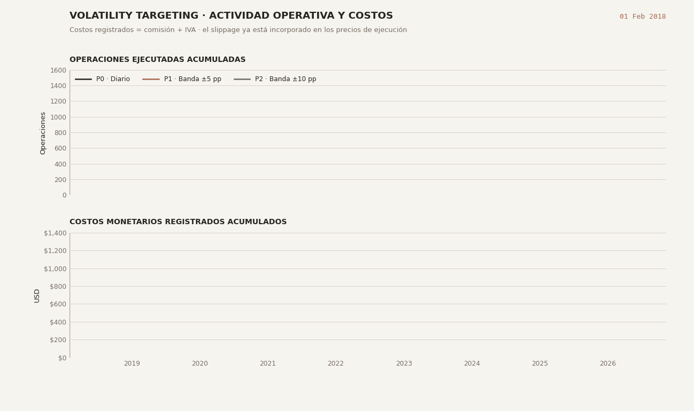
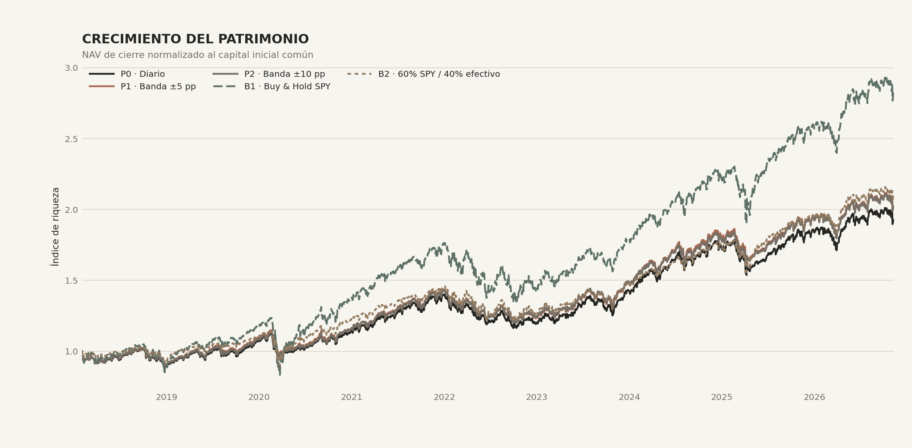
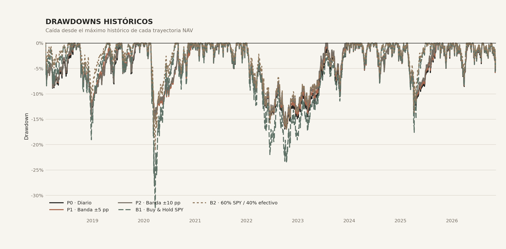

}}" hidden>

  <a href="https://github.com/ADRIANVM117/quant-research-notes/tree/main/volatility_target/01_rebalancing_policies" target="_blank" rel="noopener noreferrer">
    
    Repositorio y documentaciónGitHub
  </a>
  

En la entrega anterior construí un motor de backtesting capaz de traducir una señal de volatilidad en decisiones, órdenes y posiciones simuladas. Era un paso necesario antes de comparar políticas de inversión: una estrategia no solo depende de su regla de exposición, sino también de cómo se ejecuta y qué fricciones enfrenta.

Con esa infraestructura definida, la siguiente pregunta es más económica que mecánica: **¿qué ocurre cuando distintas políticas utilizan la misma señal, pero rebalancean con diferente frecuencia?**

Las bandas de rebalanceo parecen atractivas porque permiten reducir operaciones. Sin embargo, operar menos no garantiza mejores resultados. Menos actividad puede significar menores costos, pero también una cartera que permanece más alejada de la exposición deseada.

En esta entrega comparo tres políticas construidas sobre una misma señal EWMA. El objetivo no es declarar una ganadora, sino entender qué consecuencias económicas producen sus decisiones cuando las evaluamos bajo reglas contables consistentes.

{#fig-vt03-cumulative-costs fig-alt="GIF con operaciones ejecutadas acumuladas y costos monetarios registrados acumulados para P0, P1 y P2, con cursor temporal común."}

La diferencia operativa es evidente. Pero para entender su verdadero significado necesitamos mirar también el crecimiento del patrimonio y los riesgos experimentados durante el recorrido.

## 1. Cinco carteras bajo una misma contabilidad

Para evaluar las consecuencias económicas del rebalanceo, comparé cinco carteras bajo una estructura contable homogénea.

Las primeras tres utilizan la misma señal de volatilidad objetivo:

- **P0 — Rebalanceo diario:** intenta ajustar la exposición hacia el peso objetivo en cada sesión.
- **P1 — Banda ±5 pp:** rebalancea cuando la desviación del peso efectivo supera cinco puntos porcentuales.
- **P2 — Banda ±10 pp:** permite desviaciones mayores antes de intervenir.

Incorporé también dos benchmarks: **B1, Buy & Hold SPY**, que mantiene una posición inicial completa en el activo, y **B2, 60% SPY / 40% efectivo**, que conserva su asignación inicial sin rebalanceos posteriores.

Estos benchmarks proporcionan referencias económicas, pero no buscan el mismo objetivo de volatilidad ni asumen necesariamente riesgos equivalentes.

Todas las carteras comparten calendario, capital inicial, moneda de valoración y convenciones contables consistentes. Sus reglas de inversión son diferentes, pero la metodología utilizada para registrar posiciones, dividendos, efectivo y costos es comparable.

Lo primero que observé fue una divergencia operativa considerable. **P0 ejecutó 1,547 operaciones**, frente a **263 en P1** y **115 en P2**. Los costos registrados también disminuyeron: de **USD 1,278.52** en P0 a **USD 263.00** y **USD 115.00**, respectivamente.

Estos costos corresponden a comisiones e IVA. El deslizamiento también afecta económicamente a las carteras, pero ya está incorporado en los precios de ejecución.

La interpretación inicial favorece a las bandas: menos operaciones y menores costos registrados. Sin embargo, una política puede ahorrar fricciones y terminar con una trayectoria de patrimonio menos atractiva. Por eso necesitamos examinar qué ocurrió con el capital.

## 2. Operar menos no basta: crecimiento del capital y benchmarks

Reducir la frecuencia de rebalanceo tiene un beneficio operativo evidente, pero la pregunta importante es qué ocurre con el patrimonio que administramos.

Para investigarlo, construí un índice de riqueza para cada cartera utilizando su valor liquidativo (*NAV*) y una misma base de capital inicial. Esto permite observar cómo habría evolucionado una unidad de patrimonio durante la muestra histórica.

El NAV incorpora las posiciones, el efectivo, los dividendos y los efectos económicos de la ejecución simulada. Por tanto, no es necesario descontar nuevamente los costos ni reconstruir el rendimiento utilizando únicamente precios ajustados.

{#fig-vt03-normalized-wealth fig-alt="Gráfica de riqueza normalizada desde NAV de P0, P1, P2, Buy and Hold SPY y 60% SPY / 40% efectivo."}

Los resultados muestran diferencias que no pueden explicarse únicamente por el número de operaciones. **P1 y P2 registraron un crecimiento geométrico ligeramente superior al de P0** en esta muestra. Sin embargo, esto no identifica cuánto de la diferencia proviene de menores costos y cuánto de las distintas exposiciones mantenidas durante el recorrido.

También observé que **Buy & Hold SPY terminó con la mayor riqueza acumulada**. Pero su estrategia era fundamentalmente distinta: mantener exposición al mercado sin intentar ajustarse a una volatilidad objetivo del 12%.

Comparar solamente el capital final podría favorecer a quien asumió un riesgo diferente. El benchmark de 60% SPY y 40% efectivo aporta otra referencia, basada en una exposición inicialmente moderada que no responde a cambios en la volatilidad.

Estas comparaciones permiten estudiar las consecuencias económicas de cada política, pero dejan una pregunta pendiente: **¿qué pérdidas y qué volatilidad tuvimos que experimentar para obtener esos resultados?**

## 3. El precio del riesgo: volatilidad y drawdowns

Observar el crecimiento del capital es importante, pero no nos dice cómo fue el recorrido. Dos carteras pueden terminar con resultados similares y haber experimentado riesgos muy diferentes.

Para estudiar esta dimensión, evalué la volatilidad realizada y los *drawdowns* históricos de las cinco alternativas. La primera resume la variabilidad observada de sus rendimientos; los segundos muestran cuánto llegó a caer cada cartera respecto al máximo de patrimonio alcanzado hasta ese momento.

Esta distinción es especialmente relevante en volatilidad objetivo. **Estimar el riesgo y ajustar la exposición para perseguir un objetivo no garantiza que la volatilidad realizada coincida exactamente con él.**

En la muestra, **P0 registró una volatilidad realizada anualizada del 11.89%**, mientras que P1 y P2 alcanzaron **11.77% y 11.81%**, respectivamente. Las tres quedaron próximas al objetivo del 12%, aunque esa observación agregada no demuestra que las bandas proporcionen el mismo control del riesgo a lo largo del tiempo.

También encontré diferencias en las pérdidas máximas desde un máximo histórico: **−16.95% en P0, −16.32% en P1 y −16.05% en P2**.

{#fig-vt03-historical-drawdowns fig-alt="Gráfica de drawdowns históricos de P0, P1, P2, Buy and Hold SPY y 60% SPY / 40% efectivo."}

La gráfica revela algo que el patrimonio final no muestra: una pérdida no termina cuando el mercado deja de caer. Mientras el capital permanece por debajo de su máximo anterior, la cartera continúa atravesando un periodo de recuperación.

En esta investigación, los episodios de máximo drawdown de las cinco alternativas lograron recuperarse dentro de la muestra. Aun así, sus diferencias de profundidad y duración muestran por qué el riesgo no debe resumirse únicamente mediante una cifra terminal.

P1 y P2 registraron una volatilidad y un drawdown máximo ligeramente menores que P0. Son resultados interesantes, pero **todavía no justifican concluir que las bandas mejoran el control del riesgo**.

## 4. Menores costos no significan necesariamente mejores decisiones

Esta investigación comenzó con una pregunta sencilla: si tres políticas utilizan la misma estimación de volatilidad, ¿qué cambia cuando permitimos que sus carteras se rebalanceen con distinta frecuencia?

Los resultados muestran que las bandas pueden reducir considerablemente la actividad operativa y los costos de implementación. En esta muestra, P1 y P2 también registraron un crecimiento geométrico ligeramente superior y drawdowns máximos algo menores que P0.

Sin embargo, **observar un resultado favorable no equivale a demostrar que una política sea superior**.

Las bandas modifican más que los costos. También cambian las exposiciones mantenidas durante el recorrido y cuánto permitimos que la cartera se aleje de la asignación deseada. Por eso no podemos atribuir directamente las diferencias de crecimiento al ahorro de operaciones.

Esta evaluación me permitió pasar de estudiar cómo se ejecuta una política a investigar sus consecuencias económicas. Pero también dejó claro el siguiente problema: **¿cuánto podemos confiar en diferencias observadas dentro de una única trayectoria histórica?**

En la próxima entrega estudiaré su incertidumbre estadística, la estabilidad de los resultados y el seguimiento del objetivo de volatilidad.

Antes de elegir una política para mi Quant Desk, necesito distinguir lo que ocurrió en el backtest de lo que realmente puedo inferir a partir de él.

  <a href="https://github.com/ADRIANVM117/quant-research-notes/tree/main/volatility_target/01_rebalancing_policies" target="_blank" rel="noopener noreferrer">
    
    Repositorio y documentaciónGitHub
  </a>
  

