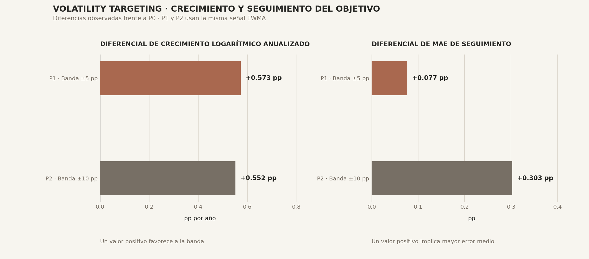
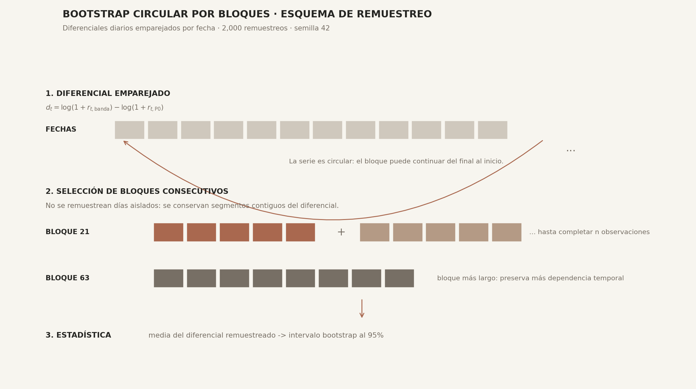
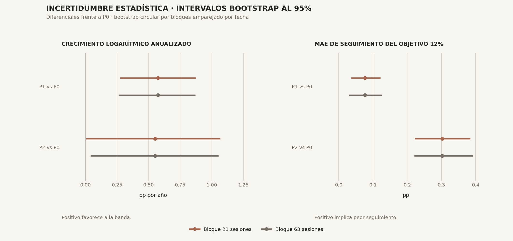

}}" hidden>

  <a href="https://github.com/ADRIANVM117/quant-research-notes/blob/main/volatility_target/01_rebalancing_policies/03_economic_statistic_evaluation.ipynb" target="_blank" rel="noopener noreferrer">
    
    Notebook de investigaciónGitHub
  </a>
  

En la entrega anterior evalué las consecuencias económicas de tres políticas de rebalanceo construidas sobre una misma señal EWMA. Las bandas redujeron considerablemente las operaciones y los costos, mientras que sus resultados de crecimiento y riesgo presentaron diferencias relativamente pequeñas frente al rebalanceo diario.

Hasta ese momento, la investigación describía lo que había ocurrido en una trayectoria histórica.

Pero apareció una pregunta más difícil: **¿cuánto podemos confiar en esas diferencias antes de utilizarlas para tomar decisiones de inversión?**

Un resultado favorable en un backtest no necesariamente representa una ventaja persistente. Puede depender de las condiciones particulares del periodo analizado, de la variabilidad de los mercados o de decisiones tomadas durante el propio desarrollo de la investigación.

En esta entrega examino la incertidumbre de las diferencias observadas y una segunda dimensión igualmente importante: si las bandas preservaron el control de riesgo que intentábamos conseguir.

## 1. Dos resultados que apuntan en direcciones distintas

La comparación principal de esta investigación es P1, con una banda de ±5 puntos porcentuales, frente a P0, que rebalancea diariamente. P2, con una banda de ±10 puntos, constituye una comparación secundaria.

Para evaluar su posible contribución utilicé dos métricas complementarias.

La primera mide el **diferencial de crecimiento logarítmico anualizado**, construido a partir de los rendimientos diarios de las carteras. Un valor positivo indica mayor crecimiento observado frente a P0.

La segunda mide el **error medio absoluto (MAE) de seguimiento del objetivo de volatilidad del 12%**, utilizando ventanas móviles de 21 sesiones. En este caso, un diferencial positivo significa que la política se alejó más del riesgo deseado.

Esta distinción revela un resultado importante: las dos bandas registraron un crecimiento logarítmico ligeramente superior al de P0, pero también errores medios de seguimiento mayores.

{#fig-vt04-growth-tracking fig-alt="Dos paneles comparan P1 y P2 frente a P0: crecimiento logarítmico anualizado positivo y mayor error medio absoluto de seguimiento del objetivo de volatilidad."}

Por tanto, no estamos buscando simplemente la política que ganó más dinero. Estamos investigando si el crecimiento adicional observado podría justificar las desviaciones de riesgo que aceptamos.

## 2. La dependencia temporal también importa

Una dificultad de trabajar con series financieras es que las observaciones no siempre son independientes.

Aunque los rendimientos diarios pueden mostrar poca autocorrelación, su volatilidad presenta persistencia. Además, nuestras medidas de seguimiento utilizan ventanas móviles superpuestas de 21 sesiones, lo que introduce dependencia entre observaciones consecutivas.

Para cuantificar la incertidumbre utilicé un **bootstrap circular por bloques**, emparejado por fecha.

En lugar de remuestrear días aislados, el procedimiento selecciona segmentos consecutivos de los diferenciales entre políticas. Esto preserva parte de la estructura temporal y mantiene alineadas las comparaciones realizadas sobre los mismos días de mercado.

Realicé **2,000 remuestreos**, utilizando bloques de 21 sesiones y una semilla fija para facilitar la reproducibilidad. También repetí el análisis con bloques de 63 sesiones para evaluar la sensibilidad de los intervalos a esta decisión metodológica.

{#fig-vt04-circular-bootstrap fig-alt="Diagrama de diferenciales diarios emparejados por fecha, segmentos consecutivos circulares y bloques de 21 y 63 sesiones usados para estimar intervalos bootstrap."}

El método no crea nuevos periodos históricos independientes. Sus intervalos cuantifican incertidumbre bajo los supuestos del remuestreo y dentro de la muestra investigada, no eliminan las limitaciones de haber utilizado previamente esos datos durante el desarrollo del modelo.

## 3. ¿Qué nos dicen realmente los intervalos de confianza?

El crecimiento logarítmico anualizado observado favoreció a ambas bandas frente a P0.

Para P1, el diferencial fue de **+0.573 puntos porcentuales**, con un intervalo bootstrap del 95% de **[0.275, 0.874]** utilizando bloques de 21 sesiones.

P2 registró **+0.552 puntos porcentuales**, con un intervalo de **[0.005, 1.067]**.

Ambos intervalos quedaron por encima de cero, aunque el límite inferior de P2 fue particularmente cercano a él.

Estos resultados proporcionan evidencia favorable al crecimiento incremental dentro del marco retrospectivo utilizado. Sin embargo, no demuestran que las bandas mantendrán esa ventaja en datos futuros.

La longitud del bloque también forma parte de las decisiones que condicionan nuestra inferencia. Por eso es importante contrastar los resultados obtenidos con 21 y 63 sesiones, en lugar de presentar un único intervalo como una conclusión definitiva.

Y aún falta examinar el otro lado del problema: **si una política mostró mayor crecimiento, ¿qué ocurrió con su capacidad para seguir el objetivo de riesgo?**

## 4. Un deterioro estadístico no determina su importancia económica

El objetivo de volatilidad era del 12% anual. Para evaluar su seguimiento, calculé la volatilidad realizada de cada cartera mediante ventanas móviles de 21 sesiones y medí la distancia absoluta respecto a ese objetivo.

Frente a P0, el error medio aumentó **0.077 puntos porcentuales en P1** y **0.303 puntos porcentuales en P2**.

Los intervalos bootstrap del diferencial de MAE permanecieron por encima de cero para ambas políticas y ambas longitudes de bloque. Esto refuerza la evidencia retrospectiva de un mayor error de seguimiento, pero no establece por sí solo si ese deterioro es económicamente aceptable.

Estas diferencias indican una menor precisión promedio de seguimiento en la muestra, pero no determinan por sí solas si el deterioro es económicamente aceptable.

{#fig-vt04-bootstrap-intervals fig-alt="Dos paneles con estimaciones puntuales e intervalos bootstrap del 95% para P1 y P2 frente a P0, bajo bloques de 21 y 63 sesiones, para crecimiento y MAE de seguimiento."}

Aquí aparece una distinción estadística fundamental: **que un intervalo incluya cero no demuestra que dos políticas sean equivalentes**.

Para afirmar que una banda mantiene un control de riesgo suficientemente próximo al de P0 necesitaríamos definir previamente cuánto deterioro estamos dispuestos a aceptar y evaluar formalmente esa condición de no inferioridad.

No establecí ese margen antes de observar los resultados. Por tanto, no sería correcto concluir retrospectivamente que las bandas preservan el riesgo sin un deterioro material.

Además, el límite de exposición del 100% puede impedir alcanzar el objetivo del 12% en determinados periodos, incluso cuando la política sigue correctamente sus reglas.

El seguimiento del riesgo necesita interpretarse considerando tanto las decisiones de rebalanceo como las restricciones del propio sistema.

## 5. Una candidata de investigación no es todavía una estrategia validada

La conclusión de esta primera etapa de Volatility Targeting es más matizada de lo que habría parecido al observar únicamente las operaciones y los costos.

Las bandas de rebalanceo redujeron la fricción operativa y mostraron diferenciales positivos de crecimiento logarítmico en la muestra. Al mismo tiempo, toleraron mayores errores de seguimiento del objetivo de volatilidad.

El bootstrap permitió cuantificar parte de la incertidumbre de esas diferencias, pero **no transformó una investigación retrospectiva en una validación independiente fuera de muestra**.

Por ahora, considero P1 y P2 candidatas para continuar investigando, no políticas autorizadas para operar capital real.

Esta distinción será importante en la siguiente etapa. Al incorporar GARCH, no bastará con obtener pronósticos de volatilidad aparentemente mejores: necesitaremos investigar si esa mejora modifica nuestras decisiones de exposición y produce beneficios económicos que resistan una evaluación rigurosa.

**El siguiente paso no es elegir al ganador del backtest, sino mejorar la evidencia con la que tomaremos esa decisión.**

  <a href="https://github.com/ADRIANVM117/quant-research-notes/blob/main/volatility_target/01_rebalancing_policies/03_economic_statistic_evaluation.ipynb" target="_blank" rel="noopener noreferrer">
    
    Notebook de investigaciónGitHub
  </a>
  

