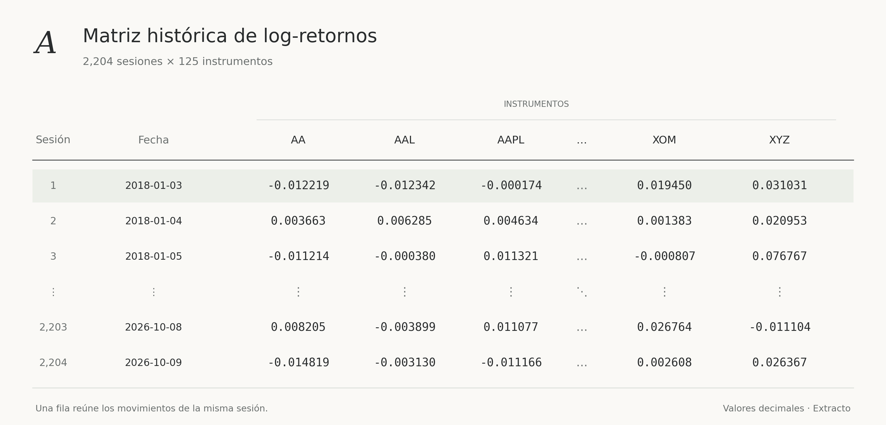
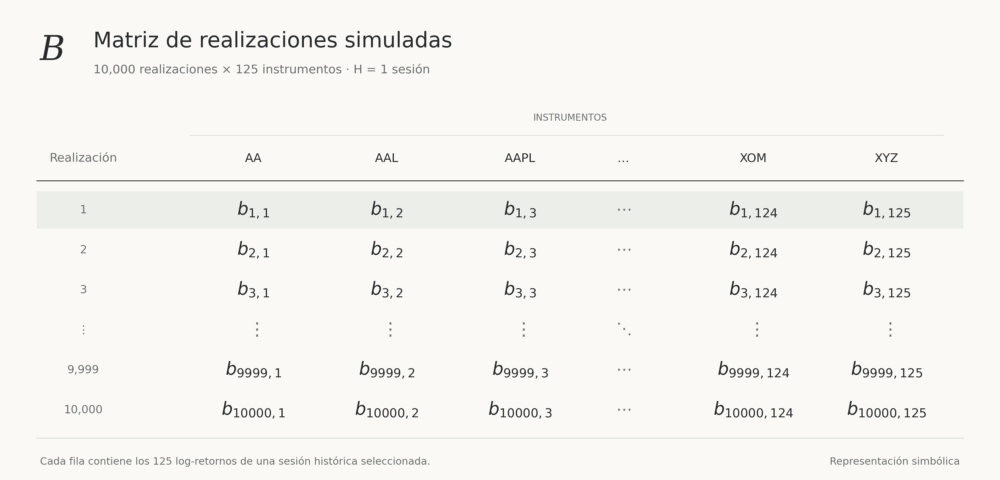
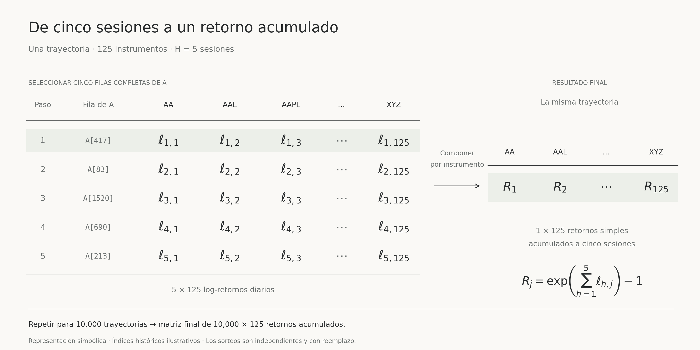
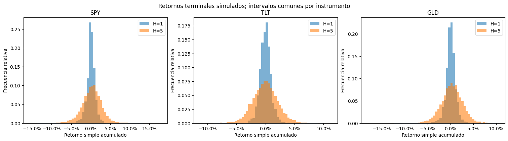
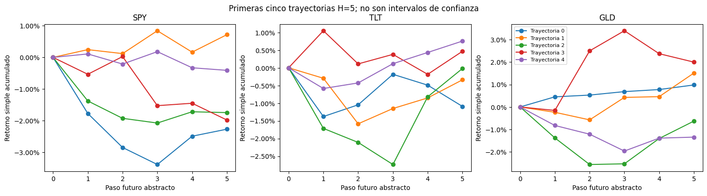
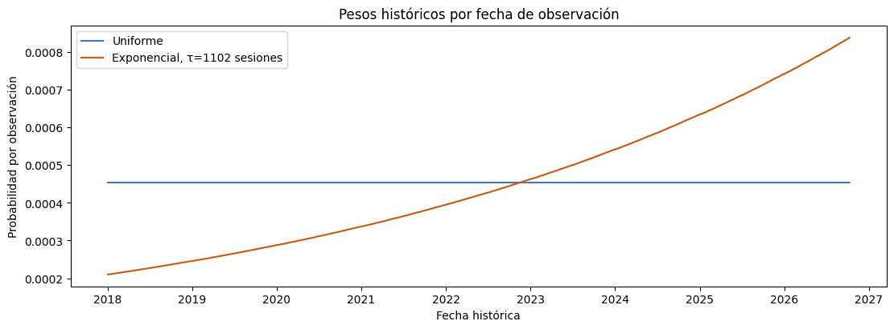
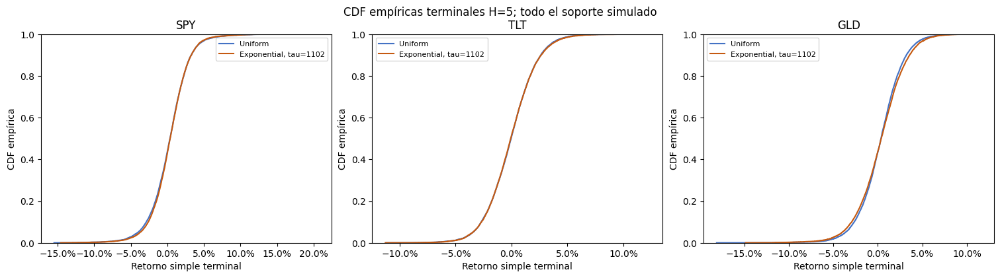

Este es el primer post que publico en mi página personal, aunque la serie comenzó antes en mi [Substack](https://substack.com/@radian117). Por eso, quiero empezar explicando brevemente qué me motivó a escribirla.

La idea detrás de esta serie es compartir el desarrollo del motor de portafolio que utilizo en mi día a día, explicando sus componentes a través de notebooks construidas con datos reales. Mi objetivo es compartir conocimiento y explorar métodos que van más allá del marco clásico de media-varianza y Black-Litterman.

El trabajo está inspirado en el enfoque de [Anton Vorobets](https://antonvorobets.substack.com/) y, en particular, en su libro **Portfolio Risk Management**.

En esta entrega trabajamos con datos históricos disponibles hasta el **9 de octubre de 2026**. El objetivo es entender cómo generar escenarios, qué cambia al modificar los pesos de las observaciones y cómo interpretar los resultados obtenidos.

La notebook correspondiente a esta entrega está disponible [aquí](https://github.com/ADRIANVM117/data-science-portfolio/blob/main/scenario-portfolio-lab/notebooks/03_joint_resampling.ipynb), junto con las demás notebooks de la serie en mi repositorio de [GitHub](https://github.com/ADRIANVM117/data-science-portfolio/tree/main/scenario-portfolio-lab).

## Datos de partida: la matriz A

Comencemos por los datos de entrada. Llamaré **A** a una matriz de **2,204 sesiones históricas × 125 instrumentos**. Sus valores son retornos calculados a partir de precios ajustados reales: cada fila corresponde a una sesión histórica y cada columna a un instrumento.

Leer una fila completa de **A** significa observar cómo se movieron los 125 instrumentos durante una misma sesión de mercado.

{#fig-matriz-a fig-alt="Matriz de retornos históricos reales con 2,204 sesiones y 125 instrumentos."}

Esta matriz será nuestro punto de partida para generar posibles movimientos bajo un modelo muy simple. Para producir una realización de una sesión, selecciono al azar un renglón completo de **A**. Inicialmente, cada sesión histórica tiene la misma probabilidad de ser elegida, es decir, \(1/2204\).

El muestreo se realiza **con reemplazo**: después de cada selección, todos los renglones siguen disponibles, de modo que una misma observación puede aparecer varias veces.

Seleccionar el renglón completo conserva los movimientos simultáneos observados históricamente. Si en una fecha **SPY** cayó mientras **TLT** y **GLD** subieron, esa combinación se recupera junta. Si, en cambio, sorteáramos cada instrumento por separado, romperíamos esa correspondencia histórica entre activos.

Repito este procedimiento **10,000 veces**. El resultado es una nueva matriz **B** de **10,000 realizaciones × 125 instrumentos**, donde cada fila representa un posible movimiento conjunto de una sesión bajo este modelo.

En **A**, cada renglón corresponde a una fecha histórica. En **B**, cada renglón corresponde a una realización simulada; la fecha original queda como referencia del origen de esos retornos.

{#fig-matriz-b fig-alt="Matriz de 10,000 escenarios simulados por 125 instrumentos."}

Al utilizar esta distribución para representar una sesión futura, el supuesto es que la muestra histórica, con pesos uniformes, constituye una referencia adecuada. Generar estas realizaciones permite estudiar las implicaciones de ese supuesto. Su capacidad predictiva, sin embargo, es una cuestión distinta y requiere una evaluación posterior.

## 2. De una sesión a un recorrido de cinco

Hasta ahora, cada realización representaba el movimiento conjunto de una sola sesión. Para ampliar el horizonte, construí trayectorias de **cinco sesiones**.

El procedimiento consiste en seleccionar, para cada trayectoria, **cinco sesiones históricas de forma independiente**, recuperando siempre juntos los **125 instrumentos** en cada paso. Repetí este proceso hasta obtener **10,000 trayectorias**.

Una vez formada cada trayectoria, sumé los **log-retornos** de cada instrumento a lo largo de las cinco sesiones y después los convertí a **retornos simples acumulados**. El resultado es una nueva distribución de **10,000 resultados a cinco sesiones por instrumento**.

La diferencia respecto al caso anterior es que ahora cada trayectoria combina movimientos reales en una secuencia que no necesariamente ocurrió de esa forma en la historia. En ese sentido, el procedimiento conserva la dependencia transversal dentro de cada sesión, pero **supone independencia entre los pasos del recorrido**.

{#fig-cinco-sesiones fig-alt="Cinco selecciones históricas forman una trayectoria de retornos acumulados por instrumento."}

## 3. ¿Cómo se reparten los resultados?

Con los retornos acumulados construí las **distribuciones terminales** y comparé los horizontes de **una** y **cinco sesiones**. Para ilustrarlo, utilicé **SPY, TLT y GLD**.

En el caso de **SPY**, la desviación estándar del retorno simple simulado pasó de **1.22%** a **2.68%**, lo que indica que los resultados a cinco sesiones quedaron más dispersos.

Los histogramas permiten ver cómo se reparte la distribución de los **10,000 resultados terminales** en cada horizonte.

{#fig-distribuciones fig-alt="Histogramas de retornos terminales simulados para SPY, TLT y GLD en horizontes de una y cinco sesiones."}

Además de la distribución final, también resulta útil observar las trayectorias que conducen a esos resultados. Para ello, seleccioné cinco trayectorias mediante **identificadores fijos**, no por el valor de su resultado final.

{#fig-trayectorias fig-alt="Cinco trayectorias de retornos acumulados seleccionadas mediante identificadores fijos."}

Ambas gráficas describen el comportamiento del modelo bajo esta construcción. Su capacidad predictiva, sin embargo, todavía no ha sido evaluada.

## 4. Dar más peso a la historia reciente

Hasta aquí, todas las sesiones históricas tenían la misma probabilidad de selección. A continuación, introduje un esquema de **ponderación exponencial**, en el que las observaciones más recientes reciben mayor probabilidad, mientras que las más antiguas permanecen disponibles.

Utilicé una **semivida de 1,102 sesiones**, con la que la mitad más reciente del historial concentra el **66.67%** de la probabilidad total, frente al **50%** que le correspondería bajo el esquema uniforme.

Este cambio modifica cuánto pesa cada observación dentro del muestreo, pero no altera la mecánica básica del modelo: las sesiones siguen siendo seleccionadas con reemplazo y la simulación continúa sin introducir dependencia entre los pasos.

{#fig-ponderacion-exponencial fig-alt="Probabilidades de selección de sesiones históricas bajo ponderación exponencial, con mayor peso en las observaciones recientes."}

La elección de esta semivida es, por ahora, **ilustrativa**. Permite estudiar cómo cambia la distribución simulada al dar más importancia a la historia reciente, pero todavía no implica una validación de capacidad predictiva.

## 5. Comparar ambas formas de ponderar la historia

Para comparar ambos esquemas, generé trayectorias de **cinco sesiones** utilizando los mismos números aleatorios en las dos simulaciones. Esto permite emparejar los resultados y observar cómo cambian al modificar las probabilidades de selección de las sesiones históricas.

En **SPY**, la media del retorno simple acumulado simulado pasó de **0.2833% con pesos uniformes** a **0.3517% con pesos exponenciales**. Por su parte, la desviación estándar disminuyó de **2.6819% a 2.5897%**.

En esta ejecución, la ponderación exponencial produjo una distribución con un promedio ligeramente mayor y una dispersión algo menor.

{#fig-sec-5 fig-alt="Distribuciones acumuladas de retornos simulados a cinco sesiones bajo ponderación uniforme y exponencial."}

La diferencia observada combina el efecto de reponderar la historia con la variabilidad de la simulación Monte Carlo. Por tanto, estos resultados describen cómo cambió la distribución bajo los supuestos elegidos, pero **no demuestran una mejora en la capacidad predictiva del modelo**.

## 6. Separar el efecto del modelo del ruido de simulación

Finalmente, comparé las medias obtenidas mediante simulación con sus **referencias analíticas**, calculadas directamente bajo cada esquema de ponderación.

El caso de **TLT** muestra por qué esta distinción es importante. En las simulaciones, la media del retorno acumulado a cinco sesiones pasó de **−0.0441% con pesos uniformes** a **−0.0334% con pesos exponenciales**, lo que inicialmente sugería una mejora.

Sin embargo, las medias exactas bajo ambos modelos mostraban lo contrario: pasaban de **−0.0267% a −0.0583%**, respectivamente. Es decir, una vez separado el ruido de simulación, el efecto del cambio de ponderación tenía el **signo opuesto** al que sugerían las realizaciones Monte Carlo.

| Medida | Uniforme | Exponencial |
| --- | ---: | ---: |
| Simulación Monte Carlo | −0.0441% | −0.0334% |
| Referencia analítica | −0.0267% | −0.0583% |

: TLT — Retorno acumulado medio a cinco sesiones {#tbl-tlt-comparison}

::: {.comparison-indicators}
::: {.comparison-indicator}
Cambio simulado

**+0.0107 pp**
:::
::: {.comparison-indicator}
Cambio analítico

**−0.0316 pp**
:::
:::

[pp = puntos porcentuales.]{.comparison-note}

Este resultado ilustra una limitación importante: **el ruido Monte Carlo puede alterar la interpretación de diferencias pequeñas**, incluso cuando la implementación es correcta. Por eso, siempre que sea posible, conviene contrastar las estimaciones simuladas con referencias analíticas del modelo.

## Próximos pasos

Hasta ahora, las probabilidades de selección permanecen fijas durante cada trayectoria y los pasos se generan independientemente.

En la **notebook 04** estudiaré el **condicionamiento por estado**: cómo describir el estado del mercado y utilizar esa información para construir escenarios condicionados. Será el siguiente paso para explorar mecanismos que permitan incorporar dependencia temporal al proceso.

La implementación, los controles y los resultados completos de esta entrega están disponibles en la [notebook 03 de GitHub](https://github.com/ADRIANVM117/data-science-portfolio/blob/main/scenario-portfolio-lab/notebooks/03_joint_resampling.ipynb).
